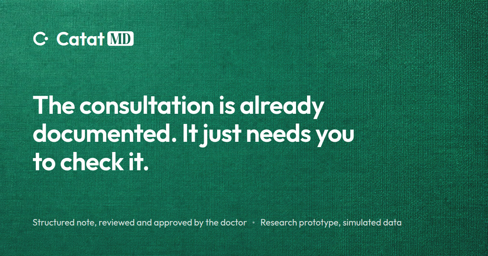
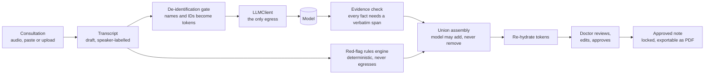

<a id="readme-top"></a>

<!-- PROJECT LOGO -->

<br />
<div align="center">
  <a href="https://catatmd.vercel.app">
    
  </a>

  <h3>CatatMD</h3>

  <p>
    An AI assistant that turns a GP consultation into a structured clinical note the doctor reviews and approves, with missing-information prompts, deterministic red flags, and guideline citations that cannot be invented.
    <br />
    <a href="https://catatmd.vercel.app"><strong>Live Demo &rarr;</strong></a>
    &middot;
    <a href="docs/README.md">Documentation</a>
    &middot;
    <a href="docs/USER-GUIDE.md">User Guide</a>
    &middot;
    <a href="https://github.com/AlaskanTuna/CatatMD/issues/new?template=bug.yml">Report a Bug</a>
    <br />
  </p>

[![TypeScript][typescript-badge]][typescript-url]
[![Bun][bun-badge]][bun-url]
[![React][react-badge]][react-url]
[![Vite][vite-badge]][vite-url]
[![Tailwind CSS][tailwindcss-badge]][tailwindcss-url]
[![Express][express-badge]][express-url]
[![Prisma][prisma-badge]][prisma-url]
[![Zod][zod-badge]][zod-url]
[![Supabase][supabase-badge]][supabase-url]
[![Vercel][vercel-badge]][vercel-url]
[![Render][render-badge]][render-url]
[![Vitest][vitest-badge]][vitest-url]

</div>

<!-- TABLE OF CONTENTS -->

## Table of Contents

<details>
  <summary>Expand</summary>
  <ol>
    <li>
      <a href="#about-the-project">About The Project</a>
      <ul>
        <li><a href="#links">Links</a></li>
        <li><a href="#screenshots">Screenshots</a></li>
        <li><a href="#how-it-works">How It Works</a></li>
        <li><a href="#features">Features</a></li>
        <li><a href="#architecture">Architecture</a></li>
        <li><a href="#project-structure">Project Structure</a></li>
        <li><a href="#tech-stack">Tech Stack</a></li>
      </ul>
    </li>
    <li>
      <a href="#getting-started">Getting Started</a>
      <ul>
        <li><a href="#prerequisites">Prerequisites</a></li>
        <li><a href="#installation">Installation</a></li>
        <li><a href="#run-tests">Run Tests</a></li>
      </ul>
    </li>
    <li><a href="#safety-by-construction">Safety By Construction</a></li>
    <li><a href="#engineering-highlights">Engineering Highlights</a></li>
    <li><a href="#documentation">Documentation</a></li>
    <li><a href="#limitations">Limitations</a></li>
    <li><a href="#challenges-and-learnings">Challenges and Learnings</a></li>
    <li><a href="#future-improvements">Future Improvements</a></li>
    <li><a href="#team">Team</a></li>
    <li><a href="#ai-disclosure">AI Disclosure</a></li>
    <li><a href="#license">License</a></li>
    <li><a href="#acknowledgments">Acknowledgments</a></li>
  </ol>
</details>

<!-- ABOUT THE PROJECT -->

<a id="about-the-project"></a>

## About The Project

A Malaysian private GP sees a **median of 32.3 patients a day**, inside a consultation the regulator prices at **10 minutes or less**. The note is written in the room, because the clinic dispenses the medicine and issues the medical certificate (MC) before the patient leaves. The realistic budget for writing it is **30 to 60 seconds**, and in one audit **98.0% of records** carried documentation problems.

CatatMD (_catat_ is Malay for "to note down") listens to the consultation, or takes a pasted or uploaded transcript, and drafts a structured note the doctor reviews. It surfaces what the record does not yet establish as questions to ask, flags danger signs with a deterministic rules engine, and suggests next steps cited only to guideline passages it retrieved. **It does not diagnose.** The doctor edits and explicitly approves every note, and stays responsible for every decision.

Clinical scope is deliberately narrow: **adult GP consultations for acute cough, sore throat and other upper respiratory symptoms.** All data in the product and this repository is synthetic.

<a id="links"></a>

### Links

| Resource             | Link                                                                                             |
| -------------------- | ------------------------------------------------------------------------------------------------ |
| Live Demo            | <https://catatmd.vercel.app>, with a guest account and a guided tour                             |
| API Health           | <https://catatmd-api.onrender.com/api/health> (free tier: the first request after idle is slow)  |
| Documentation        | [`docs/README.md`](docs/README.md), an index of every document by the question it answers        |
| Product Requirements | [`docs/PRD.md`](docs/PRD.md)                                                                     |
| Technical Reference  | [`docs/TRD.md`](docs/TRD.md), one file per section in [`docs/architecture/`](docs/architecture/) |
| Privacy Assessment   | [`docs/DPIA.md`](docs/DPIA.md)                                                                   |

<p align="right"><a href="#readme-top">&uarr;</a></p>

<a id="screenshots"></a>

### Screenshots

<table>
  <tr>
    <td width="50%" valign="top" align="left">
      
      <br />
      <strong>Consultations</strong> · Every consultation carries a status: Draft, Awaiting Review, or Approved.
    </td>
    <td width="50%" valign="top" align="left">
      
      <br />
      <strong>Review</strong> · The transcript, the drafted note and the red flags, side by side.
    </td>
  </tr>
  <tr>
    <td width="50%" valign="top" align="left">
      
      <br />
      <strong>Red-Flag Provenance</strong> · Each flag is marked Rule or AI Suggested and quotes the phrase it was heard in.
    </td>
    <td width="50%" valign="top" align="left">
      
      <br />
      <strong>Completeness Checklist</strong> · An explicit state per field, beside what the record does not establish.
    </td>
  </tr>
  <tr>
    <td width="50%" valign="top" align="left">
      
      <br />
      <strong>CatatAI</strong> · The review copilot proposes an edit as a card the doctor applies or discards. It never signs off.
    </td>
    <td width="50%" valign="top" align="left">
      
      <br />
      <strong>Approval</strong> · An explicit act, stating plainly that the note cannot be edited afterwards.
    </td>
  </tr>
</table>

<p align="right"><a href="#readme-top">&uarr;</a></p>

<a id="how-it-works"></a>

### How It Works



1. **Capture.** The doctor records the consultation (on-device, hosted, or ambient streaming with per-consultation consent), pastes a transcript, or uploads one.
2. **Rules first.** A deterministic engine checks the transcript against a versioned list of danger signs before any model sees it.
3. **De-identify.** Names, NRICs, phone numbers and other identifiers become stable tokens such as `[PATIENT_1]`, held in a request-scoped vault.
4. **Draft.** The model returns a structured note, missing-information prompts and suggestions. Every fact must quote the transcript, and every citation must name a guideline passage it was given.
5. **Assemble.** Rule hits and model output are joined as a union, so the model can add a red flag but never remove one. Tokens are restored to real names.
6. **Review and approve.** The doctor edits, asks CatatAI questions, confirms a dictated prescription, and approves. Approval is terminal.

<p align="right"><a href="#readme-top">&uarr;</a></p>

<a id="features"></a>

### Features

| Feature                            | What The Doctor Gets                                                                                                                              |
| ---------------------------------- | ------------------------------------------------------------------------------------------------------------------------------------------------- |
| **Structured Note**                | A SOAP scaffold or a Malaysian medical-record view of one record, plus the block payers read: diagnosis, medication, MC days, referral, follow-up |
| **Missing Information As Prompts** | What the consultation did not establish, phrased as a question to ask, with a rationale                                                           |
| **Deterministic Red Flags**        | Danger signs caught by rules in English, Malay and Manglish, each quoting the phrase heard; the model can only add candidates                     |
| **Cited Suggestions**              | Next steps cited to Malaysian clinical practice guideline passages retrieved for this consultation, opened at the source page                     |
| **Sore-Throat Score**              | The Modified Centor score from MOH's antimicrobial guideline, with what the transcript said offered but never selected for the doctor             |
| **CatatAI**                        | A review copilot that answers about the record and proposes edits as cards it cannot apply itself                                                 |
| **Ambient Capture**                | Live multilingual transcription with speaker separation, and machine translation for a patient speaking Urdu, Bengali, Mandarin or Tamil          |
| **Dictated Prescriptions**         | A spoken prescription read into one editable table of drug, dose, frequency and duration                                                          |
| **Approval And Report**            | An explicit, audited approval that locks the note, and a printable report                                                                         |
| **Patients And Erasure**           | Patient records with consultation history, and erasure that leaves a tamper-evident audit trail                                                   |

Every note field is **extraction, not generation**: it carries a verbatim span from the transcript, and anything the consultation never raised resolves to `NOT_ASSESSED` instead of being filled in. [`docs/USER-GUIDE.md`](docs/USER-GUIDE.md) walks through each feature.

<p align="right"><a href="#readme-top">&uarr;</a></p>

<a id="architecture"></a>

### Architecture


Three tiers: a React SPA, an Express API and Postgres. **The API is the only component that holds identifiable data.** The model sits outside the trust boundary and is reached through one de-identification gate. Frontend, API and database run in one region (Singapore) by design, for data residency.


[`docs/TRD.md`](docs/TRD.md) is the implementation reference: contracts, data model, every pipeline and every security control, one section per file.

<p align="right"><a href="#readme-top">&uarr;</a></p>

<a id="project-structure"></a>

### Project Structure

```
CatatMD/
├── shared/              @shared/types: Zod schemas, the single source of truth for both sides
├── backend/             Express 5 API
│   └── src/
│       ├── deid/            PHI detection, tokenisation, re-hydration vault   (trust boundary)
│       ├── lib/llm/         LLMClient port and provider adapters             (only model egress)
│       ├── lib/asr/         speech-recognition adapters
│       ├── redflags/        deterministic danger-sign rules engine
│       ├── guidelines/      citable guideline corpus
│       ├── retrieval/       hybrid guideline retrieval (full-text and pgvector)
│       ├── analysis/        note extraction and the evidence check
│       ├── copilot/         CatatAI, a proposal-only tool surface
│       ├── medications/     dictated-prescription parsing
│       ├── audit/           tamper-evident audit chain
│       └── routes/          HTTP surface
├── frontend/            React 19 SPA (Vite, Tailwind 4, Radix, TanStack Query)
├── prisma/              schema, migrations, seeds
├── evals/               measurements that spend real model calls, kept out of the test suite
├── corpus/cpg/          guideline manifest (raw PDFs are not committed)
├── scripts/             floor guard and walkthrough recorder
└── docs/                product, architecture, operations and decision records
```

Each source module has its own `README.md` stating what it owns, its entry points, its invariants and its tests.

<p align="right"><a href="#readme-top">&uarr;</a></p>

<a id="tech-stack"></a>

### Tech Stack

| Layer          | Technology                                                                                            |
| -------------- | ----------------------------------------------------------------------------------------------------- |
| Language       | TypeScript 5.9 everywhere, Zod schemas shared by API and SPA                                          |
| Frontend       | React 19, Vite 7, Tailwind CSS 4, Radix UI, TanStack Query 5, react-router 7                          |
| Backend        | Express 5, better-auth, Prisma 6                                                                      |
| Database       | Postgres on Supabase, with pgvector for retrieval                                                     |
| Language Model | Provider-agnostic `LLMClient`; Qwen through Alibaba Model Studio's Singapore endpoint by default      |
| Speech         | On-device recognition in the browser, plus hosted Soniox, ILMU and ElevenLabs adapters behind consent |
| Tooling        | Bun workspaces, Biome, Prettier, Vitest, Husky, commitlint, Gitleaks, Dependabot                      |
| Hosting        | Vercel (frontend), Render (API), Supabase (database), all in Singapore                                |

<p align="right"><a href="#readme-top">&uarr;</a></p>

<!-- GETTING STARTED -->

<a id="getting-started"></a>

## Getting Started

[`docs/GETTING-STARTED.md`](docs/GETTING-STARTED.md) has the full walkthrough, and [`docs/DEVELOPMENT.md`](docs/DEVELOPMENT.md) the day-to-day handbook.

<a id="prerequisites"></a>

### Prerequisites

- [Node.js](https://nodejs.org/) 24 and [Bun](https://bun.sh/) (version pinned in `package.json`)
- [Docker](https://www.docker.com/), for the local Postgres
- Optional: a Qwen or Gemini API key for live analysis, and [Gitleaks](https://github.com/gitleaks/gitleaks) for the local secret scan

<a id="installation"></a>

### Installation

```bash
git clone https://github.com/AlaskanTuna/CatatMD.git
cd CatatMD
bun install
cp .env.example .env        # point DATABASE_URL and DIRECT_URL at the local database
docker compose up -d        # Postgres on port 5434
bun run db:migrate
bun run db:seed
bun run dev                 # web on :5173, API on :3001
```

Check the API: `curl localhost:3001/api/health`.

> **Never point `.env` at a shared or production database for local work.** The test suites and every mutating control write real rows.

<a id="run-tests"></a>

### Run Tests

```bash
bun run verify                    # the CI gate: lint, format, typecheck, every test suite, floor guard
bun run --cwd frontend test       # frontend only, no database needed
bun run --cwd backend test src/deid   # one backend module, no database needed
```

The full suite runs about 3,600 tests, including a clinical-safety acceptance suite and twelve source-scanning guard tests that fail the build if an architectural invariant is broken.

<p align="right"><a href="#readme-top">&uarr;</a></p>

<a id="safety-by-construction"></a>

## Safety By Construction

The safety argument is not "a doctor reviews everything". Doctors do not reliably catch well-formed AI errors, so each property below is enforced in code and checkable by someone with no reason to trust the authors.

| Property                                  | How It Is Enforced                                                                                                                              |
| ----------------------------------------- | ----------------------------------------------------------------------------------------------------------------------------------------------- |
| **No identifier reaches a model**         | `LLMClient` accepts only a `Deidentified` branded string that only `deid/` can mint, and re-scans its payload before every call, failing closed |
| **The model cannot suppress a red flag**  | The rules engine runs first, its results are never shown to the model, and assembly is a union, never a filter                                  |
| **Citations cannot be invented**          | The request-time schema narrows each citation id to the passages retrieved, so any other reference fails validation before the doctor sees it   |
| **Unknown is never recorded as negative** | Six explicit assertion states; a fact whose evidence does not match the transcript verbatim is forced to `NOT_ASSESSED`                         |
| **No diagnosis is generated**             | The diagnosis field is filled only from a verbatim span where the doctor states it; the model is never asked what the diagnosis is              |
| **Approval is a human act**               | Approval is an explicit state transition with an audit event, and terminal; a guard test fails if any other path can reach `approved`           |
| **Nothing sensitive is logged**           | Logs and audit events carry ids and detector labels, never transcript text, note content or vault entries                                       |

**The finding it was built against.** Against a live model, a one-line transcript ("cough 3 days, no fever") produced a note denying haemoptysis, chest pain and six other findings nobody raised, in **5 of 5 runs**. The model fabricates in proportion to how sparse the transcript is, which is exactly the input this product serves. The evidence check and assertion states exist because of that measurement ([`docs/architecture/21-llm-guardrail-architecture.md`](docs/architecture/21-llm-guardrail-architecture.md)).

**Audio is the stated exception to "de-identify before egress".** Audio cannot be tokenised, so on-device recognition is the default, and every hosted path needs an explicit per-consultation consent. Each path, its region and its consent rule are set out in [`docs/architecture/20-asr-contract.md`](docs/architecture/20-asr-contract.md) and assessed in [`docs/DPIA.md`](docs/DPIA.md).

<p align="right"><a href="#readme-top">&uarr;</a></p>

<a id="engineering-highlights"></a>

## Engineering Highlights

- **Invariants as tests.** Twelve `no-stray-*` tests scan the source tree: one provider SDK repo-wide, one minter of the `Deidentified` brand, one path to `approved`, a fixed inventory of outbound `fetch` and `WebSocket` calls, and no audio persisted in the browser.
- **A provider is an adapter.** Qwen, Gemini and DeepSeek sit behind one OpenAI-compatible port, so a data-residency change is configuration, not a rewrite.
- **Hybrid retrieval over 109 guideline documents.** Postgres full-text and pgvector legs fused by reciprocal rank fusion, scoped per clinical profile, with page-level provenance and licence-aware rendering.
- **Multilingual de-identification.** Names and identifiers spoken in English, Malay, Mandarin and Tamil, including identifiers read aloud as number words, with measured recall.
- **A tamper-evident audit chain.** Each audit event hashes its predecessor, and patient erasure leaves tombstones rather than breaking the chain.
- **Measured, not asserted.** Model behaviour, analysis latency and speech accuracy per language are measured by scripts in [`evals/`](evals/), and the figures in the docs cite their run.
- **A quality floor.** `bun run verify` fails on a new lint suppression, a skipped or focused test, or an empty `catch`, unless a maintainer signs it off in the commit.

<p align="right"><a href="#readme-top">&uarr;</a></p>

<a id="documentation"></a>

## Documentation

| Question                            | Document                                                                                           |
| ----------------------------------- | -------------------------------------------------------------------------------------------------- |
| What does it do, for whom, and why? | [`docs/PRD.md`](docs/PRD.md), [`docs/PRODUCT.md`](docs/PRODUCT.md)                                 |
| How do I use it?                    | [`docs/USER-GUIDE.md`](docs/USER-GUIDE.md)                                                         |
| How do I run it and work on it?     | [`docs/GETTING-STARTED.md`](docs/GETTING-STARTED.md), [`docs/DEVELOPMENT.md`](docs/DEVELOPMENT.md) |
| How is it built?                    | [`docs/TRD.md`](docs/TRD.md) and [`docs/architecture/`](docs/architecture/)                        |
| Why is it built this way?           | [`docs/decisions/`](docs/decisions/), [`docs/research/`](docs/research/)                           |
| How is it deployed and operated?    | [`docs/operations/`](docs/operations/)                                                             |
| How is patient data protected?      | [`docs/DPIA.md`](docs/DPIA.md)                                                                     |
| What does this term mean?           | [`docs/GLOSSARY.md`](docs/GLOSSARY.md)                                                             |
| How do I contribute?                | [`.github/CONTRIBUTING.md`](.github/CONTRIBUTING.md)                                               |

The full index is [`docs/README.md`](docs/README.md).

<p align="right"><a href="#readme-top">&uarr;</a></p>

<a id="limitations"></a>

## Limitations

- **No clinician has validated the output**, and all data is synthetic. CatatMD is a prototype, not a medical device, and is not for clinical use.
- **Regulatory posture is conceded, not escaped.** Red flags with cited suggestions are clinical decision support, which in Malaysia is Class B medical-device territory. The architecture is designed as the compliance strategy ([`docs/PRD.md`](docs/PRD.md) section 11).
- **De-identification is pattern-based and best-effort.** Measured gaps, such as some identifiers read aloud, are listed rather than hidden.
- **Two hosted speech destinations leave the region**, because no in-region streaming recogniser handled Malay, English and Chinese switching with speaker separation. The transfer basis is recorded as open in [`docs/DPIA.md`](docs/DPIA.md).
- **No EMR write-back.** Malaysian private GP systems publish no common API; PDF export is the interim.
- **It may be slower than a handwritten line** for a three-minute consultation. The claim is documentation quality and a safety net, not time saved.

<p align="right"><a href="#readme-top">&uarr;</a></p>

<a id="challenges-and-learnings"></a>

## Challenges and Learnings

- **Prompts are the weakest control.** A system-prompt rule fails silently; that is how the fabricated negatives above happened. Structural constraints (enums, ID-constrained citations) and deterministic code fail loudly, so they carry the safety claims.
- **Sparse input is the dangerous input.** The model invented the most on the shortest transcripts, the very consultations a busy GP produces.
- **Code-switching is the norm.** Malaysian consultations mix English, Malay, Manglish, Mandarin and Tamil mid-sentence, which shaped the red-flag lexicon, the de-identification detectors and the choice of speech provider.
- **A consent control can quietly fail open.** For three weeks a remembered device preference stood in for per-patient consent; it was caught, split back into two controls, and pinned by a test.
- **SOAP is a scaffold, not a Malaysian norm.** No local rule mandates it, and the note payers read has fields SOAP has no home for, so the record offers both views of one note.

<p align="right"><a href="#readme-top">&uarr;</a></p>

<a id="future-improvements"></a>

## Future Improvements

- [ ] A practising-GP validation study of note quality and red-flag recall ([#251](https://github.com/AlaskanTuna/CatatMD/issues/251), [#210](https://github.com/AlaskanTuna/CatatMD/issues/210))
- [ ] IC-scan patient registration ([#386](https://github.com/AlaskanTuna/CatatMD/issues/386)) and an integration path for clinic-management systems ([#387](https://github.com/AlaskanTuna/CatatMD/issues/387))
- [ ] Tokenise identifiers read in Tamil number words and dates of birth said as words ([#440](https://github.com/AlaskanTuna/CatatMD/issues/440), [#441](https://github.com/AlaskanTuna/CatatMD/issues/441))
- [ ] Synthetic Tamil, Mandarin and Cantonese consultations for measurement ([#249](https://github.com/AlaskanTuna/CatatMD/issues/249))
- [ ] A switchable guideline corpus per jurisdiction, once reuse terms are confirmed ([#220](https://github.com/AlaskanTuna/CatatMD/issues/220), [#250](https://github.com/AlaskanTuna/CatatMD/issues/250))

See the [open issues](https://github.com/AlaskanTuna/CatatMD/issues) for the full list.

<p align="right"><a href="#readme-top">&uarr;</a></p>

<!-- TEAM -->

<a id="team"></a>

## Team

<table>
  <tr>
    <td align="center" width="25%">
      <a href="https://github.com/AlaskanTuna"></a><br />
      <b>Hee Zi Jie</b><br />
      <a href="https://github.com/AlaskanTuna">@AlaskanTuna</a><br />
      <sub>Project lead. Architecture and the PHI boundary, the review screen and note templates, consultation and patient flows, the API, and hosting.</sub>
    </td>
    <td align="center" width="25%">
      <a href="https://github.com/Andersonnn7788"></a><br />
      <b>Ling Jing Jie</b><br />
      <a href="https://github.com/Andersonnn7788">@Andersonnn7788</a><br />
      <sub>Ambient capture end to end, hosted and on-device speech recognition with their measurements, Malay red-flag and de-identification coverage, and the guideline corpus.</sub>
    </td>
    <td align="center" width="25%">
      <a href="https://github.com/DebbieLim98"></a><br />
      <b>Lim Yii Tien</b><br />
      <a href="https://github.com/DebbieLim98">@DebbieLim98</a><br />
      <sub>The GP usability study and the changes it produced: question-form missing information, the Malaysian record grouping, and the model-language safety filter.</sub>
    </td>
    <td align="center" width="25%">
      <a href="https://github.com/WeeKen99"></a><br />
      <b>Goh Wee Ken</b><br />
      <a href="https://github.com/WeeKen99">@WeeKen99</a><br />
      <sub>Guideline licensing research, practising-GP interviews, and competitive positioning against established AI scribes.</sub>
    </td>
  </tr>
</table>

<a href="https://github.com/AlaskanTuna/CatatMD/graphs/contributors">
  
</a>

<p align="right"><a href="#readme-top">&uarr;</a></p>

<a id="ai-disclosure"></a>

## AI Disclosure

Claude Code and Codex were used throughout development and testing, under the rules in [`AGENTS.md`](AGENTS.md). No commit reaches `main` without human authorization. Every regulatory and clinical position in this repository (the PDPA reading, the medical-device class assessment, the licence posture of each guideline source, and the scope boundaries) was decided by the team, not generated.

<p align="right"><a href="#readme-top">&uarr;</a></p>

<!-- LICENSE -->

<a id="license"></a>

## License

CatatMD is licensed under the [Business Source License 1.1](LICENSE). Non-production use, copying and modification are permitted; on 2029-09-21 the licence converts to the Apache License 2.0.

Guideline sources keep their own licences, set out in [`docs/architecture/11-guideline-corpus.md`](docs/architecture/11-guideline-corpus.md).

<p align="right"><a href="#readme-top">&uarr;</a></p>

<!-- ACKNOWLEDGMENTS -->

<a id="acknowledgments"></a>

## Acknowledgments

- [Ministry of Health Malaysia, National Antimicrobial Guideline, 4th ed. (2024)](https://www.pharmacy.gov.my/), the Modified Centor score and acute respiratory guidance, cited by link and summary only
- Abdullah et al. (2024), the Malaysian sore-throat Delphi consensus, CC BY-NC 3.0
- Ooi et al. (2022), _Malaysian Family Physician_, Malaysian URTI epidemiology, CC BY 4.0
- The Malaysian clinical practice guideline library indexed in [`corpus/cpg/manifest.json`](corpus/cpg/manifest.json)
- [contrib.rocks](https://contrib.rocks) and [Shields.io](https://shields.io)

<p align="right"><a href="#readme-top">&uarr;</a></p>

<!-- MARKDOWN LINKS & IMAGES -->

[typescript-badge]: https://img.shields.io/badge/TypeScript-3178C6?style=for-the-badge&logo=typescript&logoColor=white
[typescript-url]: https://www.typescriptlang.org/
[bun-badge]: https://img.shields.io/badge/Bun-000000?style=for-the-badge&logo=bun&logoColor=white
[bun-url]: https://bun.sh/
[react-badge]: https://img.shields.io/badge/React-61DAFB?style=for-the-badge&logo=react&logoColor=black
[react-url]: https://react.dev/
[vite-badge]: https://img.shields.io/badge/Vite-9135FF?style=for-the-badge&logo=vite&logoColor=white
[vite-url]: https://vite.dev/
[tailwindcss-badge]: https://img.shields.io/badge/Tailwind_CSS-06B6D4?style=for-the-badge&logo=tailwindcss&logoColor=white
[tailwindcss-url]: https://tailwindcss.com/
[express-badge]: https://img.shields.io/badge/Express-000000?style=for-the-badge&logo=express&logoColor=white
[express-url]: https://expressjs.com/
[prisma-badge]: https://img.shields.io/badge/Prisma-2D3748?style=for-the-badge&logo=prisma&logoColor=white
[prisma-url]: https://www.prisma.io/
[zod-badge]: https://img.shields.io/badge/Zod-408AFF?style=for-the-badge&logo=zod&logoColor=white
[zod-url]: https://zod.dev/
[supabase-badge]: https://img.shields.io/badge/Supabase-3ECF8E?style=for-the-badge&logo=supabase&logoColor=white
[supabase-url]: https://supabase.com/
[vercel-badge]: https://img.shields.io/badge/Vercel-000000?style=for-the-badge&logo=vercel&logoColor=white
[vercel-url]: https://vercel.com/
[render-badge]: https://img.shields.io/badge/Render-000000?style=for-the-badge&logo=render&logoColor=white
[render-url]: https://render.com/
[vitest-badge]: https://img.shields.io/badge/Vitest-6E9F18?style=for-the-badge&logo=vitest&logoColor=white
[vitest-url]: https://vitest.dev/
