# CatatMD Overview

### An Assistant That Turns A GP Consultation Into A **Reviewable** Clinical Note

_Documentation gaps surfaced as prompts to ask · Deterministic red-flag detection · Citations that cannot be fabricated_

 

  
  
  
  
  
  
  
  
  

[**Live Demo**](https://catatmd.vercel.app) · [**Requirements**](./PRD.md) · [**Technical Reference**](./TRD.md) · [**Privacy Assessment**](./DPIA.md) · [**Architecture**](#architecture-at-a-glance) · [**Repository Landing Page**](../README.md)

_Catat_, Malay for "to note down". The product documents; the doctor decides.

---

## ⚡ In Three Numbers

<table>
  <tr>
    <td align="center" width="33%"><strong>5 of 5</strong> runs in which the unguarded pipeline invented clinical negatives on a sparse transcript, the measured finding every guardrail here answers to</td>
    <td align="center" width="33%"><strong>0</strong> red flags the model is able to suppress, because the rules engine runs before it and assembly is a union, never a filter</td>
    <td align="center" width="33%"><strong>1</strong> egress point for text, type-enforced, so an un-gated string is a compile error rather than a code-review question</td>
  </tr>
</table>

<a href="#top">&#8593;</a>

---

## 📷 Screenshots

<table>
  <tr>
    <td width="33%">
Consultation list. Every consultation carries a status: Draft, Awaiting Review, or Approved.
</td>
    <td width="33%">
Three-panel review: the transcript, the drafted note, and the red flags side by side.
</td>
    <td width="33%">
Red-flag provenance. Each flag is marked <code>Rule</code> or <code>AI Suggested</code> and quotes the phrase it was heard in.
</td>
  </tr>
  <tr>
    <td width="33%">
Completeness checklist. An explicit state per field, beside what the record does not establish.
</td>
    <td width="33%">
CatatAI proposes an edit as a card the doctor applies or discards. It never signs off.
</td>
    <td width="33%">
The approval gate. An explicit act, stating plainly that the note cannot be edited afterwards.
</td>
  </tr>
</table>

<a href="#top">&#8593;</a>

---

## 🧭 The Problem

A Malaysian private GP sees a **median of 32.3 patients a day**, inside a consultation the regulator prices at **10 minutes or less**. The note is written in the room with the patient still present, because the clinic dispenses the medicine and issues the MC before that patient leaves. The realistic budget for writing it is **30 to 60 seconds**.

Five pressures follow, each measured rather than asserted:

| The Pressure                                             | The Evidence                                                                                                                                             | What It Costs The Clinic                                                    |
| -------------------------------------------------------- | -------------------------------------------------------------------------------------------------------------------------------------------------------- | --------------------------------------------------------------------------- |
| **The Note Is Written In Seconds, About 32 Times A Day** | Schedule 7 consultation banding; Sivasampu et al., PLOS One 2017                                                                                         | Every extra minute per patient is roughly half an hour of clinic time a day |
| **An Incomplete Note Is The Realistic Baseline**         | 98.0% of records carried documentation problems: history missing or inadequate in 46.5%, examination in 51.2%, diagnosis in 42.5% (Khoo et al., n=1,753) | Completeness, not speed, is where the record actually fails                 |
| **Nothing Systematically Checks For Danger Signs**       | The absence of a control, not a measured failure                                                                                                         | Whether a red flag is caught depends on recall, on the 32nd patient         |
| **Documentation Just Acquired Commercial Value**         | The consultation fee ceiling moved to RM80 (P.U.(A) 150/2026) while panels hold the effective price near RM34                                            | Charging toward the ceiling has to be justifiable on the record             |
| **The Record Is Externally Audited**                     | PMCare panel GP terms, carrying on-site audit rights on 24 hours' notice                                                                                 | A diagnosis inconsistent with the drugs dispensed is a deduction            |

**About 60% of patients arrive through a TPA or corporate panel, and the note those payers read is not SOAP.** The contractually enforced shape is condition, treatment, itemised medication dispensed, MC days, referral. Two of those fields have no home in SOAP at all, because the Malaysian GP dispenses in-house and issues the MC in the room.

<a href="#top">&#8593;</a>

---

## 🩺 What CatatMD Does About It

| What The Doctor Gets                                                                                                                                                          | Which Pressure It Answers                            |
| ----------------------------------------------------------------------------------------------------------------------------------------------------------------------------- | ---------------------------------------------------- |
| **A Structured Note From The Consultation**, SOAP scaffold plus the operational block the payer actually reads: diagnosis, medication dispensed, MC days, referral, follow-up | The 30 to 60 second budget, and the TPA audit        |
| **Missing Documentation Surfaced As Prompts To Ask**, each with a rationale                                                                                                   | The 98% incomplete-record baseline                   |
| **Deterministic Red-Flag Detection** the model can never suppress or downgrade                                                                                                | Nothing systematically checking danger signs         |
| **Clinical Suggestions Carrying Real, Inspectable Citations**                                                                                                                 | Justifying decisions on a record that gets audited   |
| **A Review Copilot That Answers About The Record** and proposes edits as cards it cannot apply itself                                                                         | Reviewing 32 notes a day without moving the decision |
| **A Sore-Throat Score The Doctor Completes**, with what the transcript plainly said offered but never selected, cited to MOH's guideline and never interpreted                | Justifying decisions on a record that gets audited   |
| **Review, Edit, And Explicit Approval** before anything is final                                                                                                              | The doctor stays the author, and stays responsible   |

Every field above is **extraction, not generation**: each carries a verbatim span from the transcript, and anything the consultation never raised resolves to `NOT_ASSESSED` rather than being quietly filled in. Acceptance criteria for each capability live in `docs/PRD.md` §9.

**Stated Honestly, Because A Doctor Will Find Out In One Clinic Session:** for a fast three-minute URTI consult this may well be slower than the handwritten line it replaces. The claim is documentation quality and a safety net that does not depend on memory. It is not a time-saving claim, and no time-saved figure is offered anywhere in this repository.

<a href="#top">&#8593;</a>

---

## 🧠 How We Tackle It

AI note-taking is already commoditised in this market, bundled into clinic systems at prices no scribe can compete with (Positioning, below, names the incumbents). So this is not positioned as another scribe. What is different is that the safety properties are **architectural rather than promised**, and each is checkable by someone who has no reason to trust us.

| The Promise Every Vendor Makes | What Is Actually Enforced Here                                                                                                         |
| ------------------------------ | -------------------------------------------------------------------------------------------------------------------------------------- |
| "Patient data is protected"    | De-identification runs on the inference path, per request, at a single egress point that refuses input which has not passed through it |
| "Our AI catches red flags"     | A deterministic rules engine runs **before** the model, and the model is never shown its output, so it has nothing to suppress         |
| "Our citations are reliable"   | The model may only cite guideline IDs from a supplied corpus; a free-text reference fails validation before the doctor ever sees it    |
| "The doctor reviews it"        | Approval is a state transition with an audit event, not a checkbox, and it is terminal                                                 |

<a href="#top">&#8593;</a>

---

## 🏗 Architecture At A Glance

The two diagrams below are the system as it actually runs. The first is what the doctor experiences; the second is what it is built from.

  <picture>
    <source media="(prefers-color-scheme: dark)" srcset="assets/diagrams/doctor-journey-dark.svg" />
    
  </picture>

Three claims the journey diagram is drawn to make checkable:

- **The Model Never Sees A Patient Identifier.** The de-identification gate sits between the stored transcript and the only egress point, and the request-scoped vault restores real names only on the way back.
- **The Model Never Sees The Rules Engine's Output**, so it cannot suppress a red flag it was never shown.
- **The Model Cannot Subtract.** Assembly is a union in both directions: deterministic red flags and deterministic gaps stand whether or not the model mentions them (`docs/TRD.md` §10, §12).

`approved` is terminal and reachable only through an explicit doctor action. The hosted transcription path is drawn dashed and outside the boundary because it is the one route by which audio can leave the device, entered only by a recorded per-consultation act (`docs/TRD.md` §20).

  <picture>
    <source media="(prefers-color-scheme: dark)" srcset="assets/diagrams/tech-stack-dark.svg" />
    
  </picture>

Three claims the stack diagram is drawn to make checkable:

- **`lib/llm/` Is The Only Text Egress**, and everything crossing that line has already passed `deid/`.
- **`lib/llm/` Now Carries Two Egress Calls, Completion And Embedding,** and both accept only de-identified text.
- **Three Audio Paths Leave The Boundary, And None Can Be De-Identified First.** Speech-to-text runs on the device by default, so it opens only when a doctor has chosen the hosted engine for the device and ticked the per-consultation consent box for that patient. The diagram draws it dashed because it sits outside the boundary, and the audio reaches it only as a relay through the API (`docs/TRD.md` §20.4). Ambient capture is the second: it never enters the API at all, streaming from the browser to the provider under a short-lived key the API mints, which is why the browser carries a guard of its own pinning that socket to one module. Post-stop refinement is the third: ElevenLabs batch speech-to-text, also browser-direct under a token the API mints (`docs/TRD.md` §20.14).

Bun workspaces · TypeScript · Zod (shared contracts) · Express 5 · Prisma 6 · better-auth · React 19 + Vite 7 + Tailwind 4 · Supabase Postgres · Vitest · Biome. Hosting: frontend to Vercel, backend to Render, database to Supabase, all three in one region by design.

<a href="#top">&#8593;</a>

---

## 📍 Status

**Both Tiers Are Built And Running.**

| Layer                | What Is Built                                                                                                                                                                                                                                                 |
| -------------------- | ------------------------------------------------------------------------------------------------------------------------------------------------------------------------------------------------------------------------------------------------------------- |
| **Backend**          | De-identification gate, deterministic red-flag engine, Malaysian guideline corpus, structured-extraction pipeline with its evidence-bound assertion check, gaps engine, authentication, synthetic fixtures                                                    |
| **Frontend**         | Consultation list, four-input capture screen, review screen carrying gap, red-flag and suggestion cards, the approval control, on-device audio capture with draft speaker labels                                                                              |
| **Hosted ASR**       | Live in production behind a device engine preference plus a per-consultation consent gate, both required (#154, #155, #190, #254)                                                                                                                             |
| **Analysis Latency** | Measured 08/09/26 on a 4-minute synthetic consultation: 54 s median end-to-end, all of it model time. Inside a 3-minute envelope, outside the 30 s target recorded in August. Reproduce with `bun run --cwd backend bench:workflow` (`docs/TRD.md` §12, #224) |
| **Ambient Capture**  | Building (#268). The consultation streams from the browser to Soniox as it happens, under a short-lived key the API mints; the API never receives the audio. No accuracy figure for that provider exists in this repo yet                                     |

`docs/TRD.md` tags every section `Built`, `Specified`, or `Open`, and never describes unwritten code as if it exists. Where implementation contradicted the specification, the TRD records which won and why rather than quietly conforming — see §3 (the assertion schema had to split in two), §5 and §7.

**No Clinician Has Reviewed Any Of It**, and all data is synthetic. See [`PRD.md` §12](./PRD.md#12-known-limitations).

<a href="#top">&#8593;</a>

---

## 🎯 Positioning — Why This Is Not "An AI Scribe"

**The Scribe Function Is Already Commoditised In Malaysia.**

| Incumbent        | Position                                                                      |
| ---------------- | ----------------------------------------------------------------------------- |
| **MedicalMet**   | AI SOAP notes bundled inside a **RM45/clinic/month** clinic management system |
| **Cliniclah**    | From **RM179**                                                                |
| **Qmed Asia**    | Ships Qmed Scribe, and already holds **ISO 13485 and MDA approval**           |
| **Heidi Health** | Opened a Singapore SEA HQ on 31 July 2026 with a free tier                    |

The marginal price of AI documentation here is effectively RM0, and Western per-clinician scribe pricing is several times the cost of an entire Malaysian CMS.

So this project does not compete on transcription. It competes on **the boundary** — three properties that are architectural rather than promised:

| Claim                                                 | Why It Is Defensible                                                                                                                              |
| ----------------------------------------------------- | ------------------------------------------------------------------------------------------------------------------------------------------------- |
| **De-Identification On The Inference Path**           | Every rival claim that could be pinned down is a _training-pipeline_ control. This one is per-request, at a single egress point, before each call |
| **Deterministic Red Flags The Model Cannot Suppress** | No scribe vendor ships this. Patient safety does not depend on model behaviour                                                                    |
| **ID-Constrained Citations**                          | Hallucinated medical references are structurally impossible, not statistically unlikely                                                           |

**Table Stakes Are Named As Table Stakes.** Doctor-approves-everything, "does not diagnose", audio-not-retained, and SOAP templates are stated by every vendor in this market. They are kept here only in their **enforced** form: a state transition with an audit event, not a sentence in a marketing page.

**Ground Already Occupied Locally Is Named Rather Than Claimed.** Browser-side NRIC tokenisation ships today at DocReport, and Malaysian CPG citation lookup is held by Qmed AskCPG, co-developed with MOH. Full analysis in `docs/PRD.md` §5.

<a href="#top">&#8593;</a>

---

## 📝 The Note Is Not Just SOAP

**SOAP Is A Review Scaffold, Not A Malaysian Norm.** No Malaysian regulation mandates it: MMC Guideline 002/2006 requires contemporaneous, chronological, signed entries and never mentions SOAP.

The review screen therefore offers two persisted views of one editable record:

| View                         | Order                                                                                                                                           |
| ---------------------------- | ----------------------------------------------------------------------------------------------------------------------------------------------- |
| **SOAP**                     | Subjective (PC, HPC, PMH, SH, FH) → Objective → Assessment → Plan                                                                               |
| **Malaysian Medical Record** | Presenting Complaint → History of Presenting Complaint → Past Medical History → Social History → Family History → Objective → Assessment → Plan |

Switching views never asks the model again and never reinterprets prose. A category the consultation did not establish stays visible as **Not established**.

What _is_ enforced is the payer contract: condition → treatment → itemised medication dispensed → MC days → referral. Two of those fields have no home in SOAP at all, because the Malaysian GP dispenses in-house and issues the MC in the room.

The note therefore carries an operational block alongside the four SOAP strings (`docs/TRD.md` §3):

| Field                  | Records                                                | When The Transcript Is Silent |
| ---------------------- | ------------------------------------------------------ | ----------------------------- |
| `diagnosis`            | The impression **the doctor stated**, verbatim-bound   | `NOT_ASSESSED`                |
| `medicationsDispensed` | Drugs the doctor named as dispensed, dose where stated | `NOT_ASSESSED`                |
| `mcDays`               | Medical-certificate days the doctor stated             | `NOT_ASSESSED`                |
| `referral`             | Referral the doctor stated                             | `NOT_ASSESSED`                |
| `followUp`             | Follow-up interval the doctor stated                   | `NOT_ASSESSED`                |

**Every One Of These Is Extraction, Not Generation.** Each carries a verbatim transcript span, and a field nobody raised resolves to `NOT_ASSESSED` rather than being defaulted to absent.

<a href="#top">&#8593;</a>

---

## 🔐 The PHI Boundary

The central architectural invariant: **no text containing patient identifiers leaves the API.**

The precise claim matters, because "we de-identify" is a word every competitor uses. What is enforced here is narrower and checkable: **de-identification applied on the inference path, before every outbound call, at a single egress point that refuses un-gated input**, with a request-scoped token vault and re-hydration on the way back.

  <picture>
    <source media="(prefers-color-scheme: dark)" srcset="assets/diagrams/phi-boundary-dark.svg" />
    
  </picture>

- **Tokenisation Is Stable Within A Request** — `[PATIENT_1]`, `[NRIC_1]` — so the model sees one consistent handle per person across the whole transcript.
- **The Vault Is Request-Scoped.** It is never a singleton, never attached to a database row, never logged, and is discarded when the handler returns.
- **Identifiers Read Aloud Are Tokenised Too, With Measured Gaps.** A spoken IC, phone or record number arrives as words, not digits, so a dedicated detector tokenises number-word runs. On 28 measured readings of one synthetic IC, 18 tokenise whole, 4 up to the transcriber's comma and 6 pass; Tamil numerals and phonetic fragments still pass ([`TRD.md` §9, Spoken Digit Runs](./architecture/09-de-identification-pipeline.md#spoken-digit-runs)).
- **Audit Events Record Detector _labels_, Never Values** (`["NRIC","NAME"]`), so the audit trail cannot become a second leak vector (`docs/TRD.md` §15).

`LLMClient.generate()` accepts only a `Deidentified` branded string, so passing a plain `string` — an accidental leak — is a compile error, not a code-review question. Two further enforcement points were open gaps in earlier drafts and were **closed on 13/08/26**:

- **Minting Is Now Locked, Not A Convention.** `markDeidentified` is no longer exported. It lives module-private inside `backend/src/deid/`, so branding a raw string anywhere else is a compile error (`docs/TRD.md` §5; decision §19 row 1, closed).
- **`DEID_FAIL_CLOSED` Now Has Runtime Effect.** `OpenAICompatibleClient.generate()` re-runs the full detector inventory over the outbound payload immediately before the network call and refuses to send if anything fires (`docs/TRD.md` §7; decision §19 row 2, closed).

The two sit at different tiers deliberately. The first stops the convenient bypass at compile time; the second catches the determined one — a `value as Deidentified` cast, which no type system can prevent — at runtime. The guard's exception carries **detector labels only, never matched values**, so the failure path cannot itself become a leak.

What remains honest to say: a deliberate cast still compiles. The claim is that it cannot reach a provider undetected, not that it cannot be written.

Detection is pattern-based and best-effort — see [`PRD.md` §12](./PRD.md#12-known-limitations).

<strong>Audio Stays On The Device By Default, With One Stated Exception</strong>

Raw audio cannot be de-identified, only transcribed. A hosted service would therefore carry un-redacted patient audio, and voice itself as a biometric identifier, outside the trust boundary before the gate ever saw it.

**Transcription Runs On The Doctor's Device.** Only the resulting transcript text reaches the API, where it enters the same pipeline as text pasted, uploaded, or picked from a fixture.

The claim stops there, because on modest clinic hardware the on-device path has a real cost. The rule is a default with a gate, not an absolute:

> **On-device is the default and the floor. Hosted is only ever entered by an explicit, recorded, per-consultation act. Failure degrades to paste, never to the cloud.**

**Two surfaces are stated exceptions to the first sentence, and only the first sentence.**

| Surface                | Streams By Default Since | What It Falls Back To                                                     |
| ---------------------- | ------------------------ | ------------------------------------------------------------------------- |
| Prescription dictation | 10/09/26 (D-001)         | On-device recognition, or typing                                          |
| Ambient capture        | 21/09/26 (D-007)         | Press to record, which has an on-device path. Ambient has none of its own |

The rest of the rule holds on both: failure degrades to press-to-record, to the device, or to typing, never to the cloud. Ambient still sends nothing without its per-consultation tick. See [`decisions/`](./decisions/README.md).

**That Last Clause Is The Load-Bearing One.** Silently switching to hosted transcription because a device is slow would be a privacy control that fails **open** under load, degrading exactly when the doctor is least able to notice. It is written down as rejected rather than left to an implementer's judgement.

The hosted adapter is **built and live**, and reaching it takes two separate acts (`docs/TRD.md` §20, §20.4):

| Control               | Question It Answers               | Scope                                            |
| --------------------- | --------------------------------- | ------------------------------------------------ |
| **Engine Preference** | Where does audio go?              | This device, remembered, set in Audio settings   |
| **Consent Gesture**   | May this patient's audio be sent? | One recording, never remembered, never inherited |

| Property         | Behaviour                                                                           |
| ---------------- | ----------------------------------------------------------------------------------- |
| **Placement**    | Above the record controls it enables, never highlighted                             |
| **Failure Copy** | The on-device failure message never mentions it                                     |
| **Effect**       | The provider key is set in production, so both together send that recording to ILMU |

**Five Capture Paths Exist, And They Leave The Device By Different Routes.**

| Path                          | Where The Audio Goes                                                                                                                                                                                                                                      | Region                                 |
| ----------------------------- | --------------------------------------------------------------------------------------------------------------------------------------------------------------------------------------------------------------------------------------------------------- | -------------------------------------- |
| Press to record, on-device    | Nowhere. The model runs in the browser                                                                                                                                                                                                                    | The device                             |
| Press to record, hosted       | One finished recording, through our API, to ILMU                                                                                                                                                                                                          | Malaysia                               |
| Ambient capture               | Streamed from the browser straight to Soniox, under a key our API mints. **A new consultation opens here**                                                                                                                                                | United States                          |
| Prescription dictation        | One phrase to Soniox, same route. On the device only when streaming is unavailable                                                                                                                                                                        | US, or device                          |
| Ambient refinement after Stop | The finished recording, once, straight from the browser to ElevenLabs batch speech-to-text under a single-use token our API mints. Untranslated ambient only, off in production until gated, live transcript on any failure ([`TRD.md`](./TRD.md) §20.14) | Vendor default, not a residency option |

**Two destinations leave the region: Soniox, reached by two paths, and ElevenLabs batch refinement after Stop, browser-direct and gated off in production.** Soniox offers the United States, the European Union, Japan and India, and no Malaysian or Singapore option. That is the honest cost of the only streaming recogniser tested here that both handles Malay, English and Chinese switching mid-sentence and tells the speakers apart (ElevenLabs' realtime model could not, [`TRD.md`](./TRD.md) §20.13), and the transfer basis is recorded as open in [`DPIA.md`](./DPIA.md) rather than treated as solved. Our servers never hold that audio. ElevenLabs offers no residency option on its default endpoint, and its retention of the uploaded recording is unmeasured ([`TRD.md`](./TRD.md) §20.14, [`DPIA.md`](./DPIA.md)).

**Prescription dictation streams by default, and it is the one audio path with no consent control left.** Dictate opens the prescription surface and the microphone with it; the disclosure and the per-consultation tick were removed on 10/09/26 on the owner's instruction, so a doctor who touches nothing sends a patient's voice to a United States endpoint on one press. Authorised and scoped to that one surface ([`TRD.md`](./TRD.md) §20.10). The cost is recorded as a cost rather than argued away: the live count of consent controls there is zero ([`decisions/`](./decisions/README.md) D-001). What did not weaken is the trail, which now records `consentAsserted: false` on that path instead of claiming an agreement nobody gave. Every failure still lands back on the device or on typing rather than on the cloud.

**Ambient Keeps Its Tick, And Lost The Other Half On 21/09/26.** A new consultation now opens in ambient ([`decisions/`](./decisions/README.md) D-007), so the capture-mode half of the rule ships already set and the per-consultation tick is the only control the doctor still exercises there. Nothing streams without it: the start dispatcher refuses, and the API rejects an ambient session request that does not assert it.

**The Split Is Deliberate, And It Was Got Wrong Once.** For three weeks the engine preference was the whole gate while the interface still said each patient was asked. A remembered agreement is one the next patient never gave, so the per-consultation half was restored and is now pinned by a test that fails if the claim and the control ever part company again (#254).

**A Recording Returns As Timestamped, Speaker-Labelled Draft Lines.** Each Doctor/Patient label is a guess from segment timing and what the sentence says, never from the voices. The doctor no longer confirms them line by line: that gate was removed in #233 because the ambient workflow replacing it has no moment to stop and tweak labels. The safety it bought moved rather than went, and the transcript now carries `labelsReviewed: false` so the red-flag engine will not drop a trigger hit on a label nobody stood behind (`docs/TRD.md` §20.2).

**Ambient capture can interpret for a patient who speaks Urdu, Bengali, Mandarin or Tamil** (#392, #393, #385). The doctor picks the patient's language before starting, and the same Soniox socket returns every line with a machine translation beneath it, so each person reads the whole conversation in their own language.

| Property                        | Behaviour                                                                                                                                                                                                             |
| ------------------------------- | --------------------------------------------------------------------------------------------------------------------------------------------------------------------------------------------------------------------- |
| **What The Safety Checks Read** | The English only. The red-flag engine and de-identification read Latin script, so the other-language half is stored beside each turn and never sent to a model                                                        |
| **Roles**                       | Taken from the language spoken: English is the doctor and anything else the patient. Still a draft, and still `labelsReviewed: false`                                                                                 |
| **Consent**                     | The tick says the patient agreed to machine translation. It is written in English only, by the owner's decision (`decisions/` D-008)                                                                                  |
| **Measured**                    | On synthetic voices only (#389). Every translation arrived directly after the words it translated, and the red-flag engine caught 12 of 12 translated warning signs after #390. **Mandarin and Tamil are unmeasured** |

**Machine Translation Is Not An Interpreter.** Nothing here measures it on real speech, speakers of Sylheti or Chittagonian are likely poorly served, and a line that comes back untranslated is counted on the review page as one the safety checks could not read. See [`TRD.md`](./TRD.md) §20.12.

**Auto-Detect Reads English, Malay, Mandarin And Tamil, And Cantonese Is Not Supported** (#218, `decisions/` D-009). The Record tab says so before capture starts.

| Language  | Measured On Production's Config, Synthetic Voices Only |
| --------- | ------------------------------------------------------ |
| Tamil     | 8.2% word error rate                                   |
| Mandarin  | 6.5% character error rate                              |
| Malay     | 9.4% word error rate                                   |
| Cantonese | 62.5% character error rate, heard as Mandarin          |

Six read lines per language, so these are indicative, not a benchmark. A Mandarin or Tamil name is tokenised where a self-introduction or a title marks it (#418); one said with neither still reaches the model in its own script. See [`TRD.md`](./TRD.md) §20.10.

**One Request Does Leave The Browser On The On-Device Path**, and it is named here rather than left to be discovered. The speech model's weights are fetched from a public CDN the first time they are needed, then cached.

| Question                    | Answer                                                                                 |
| --------------------------- | -------------------------------------------------------------------------------------- |
| **What Is It?**             | A download of public model weights, not an upload                                      |
| **What Is In It?**          | No audio, no transcript, no identifier. The request happens before any of them exist   |
| **What Does The CDN See?**  | The clinic's IP address and which model was asked for. Nothing else                    |
| **Does It Cross A Border?** | Nothing that data-residency rules attach to, because no patient data is in the request |

**Removing Even That Request Is Configuration, Not A Rebuild.** `VITE_ASR_MODEL_HOST` points the download at a mirror, the path layout matches the CDN's so mirroring is a file copy, and the last third-party request disappears. The runtime itself is already served from our own origin.

Who observes what, and why those two assets are treated differently, is set out in full in `docs/TRD.md` §20.

<strong>The Provider Is A Swappable Adapter</strong>

All three supported providers speak the OpenAI-compatible protocol and are selected by `LLM_PROVIDER`. This is a deliberate architectural commitment: it is what makes "what happens when data residency requirements change" answerable with a configuration change rather than a rewrite.

| Provider                        | Role                                    | Data Residency                                                      |
| ------------------------------- | --------------------------------------- | ------------------------------------------------------------------- |
| **Qwen** (Alibaba Model Studio) | default, the production path            | in-region endpoint                                                  |
| Gemini                          | **Local Dev Only, Synthetic Data Only** | free-tier terms permit use for product improvement and human review |
| DeepSeek                        | benchmarking only                       | PRC; raises a further PDPA s.129 cross-border question              |

**Residency, Stated Accurately.** In-region hosting is **not** "data residency solved". Under the amended PDPA (Act A1719) the whitelist regime is gone, and s.129 now requires an affirmative basis for any transfer of Malaysian data out of Malaysia, which hosting anywhere else _is_.

The claim this project makes is narrower and true: **in-region hosting, a documented s.129 basis, and a region-portable adapter.** This prototype also processes no personal data at all, because every consultation is synthetic (`docs/PRD.md` §11).

<a href="#top">&#8593;</a>

---

## 🛡 Guardrails Against Fabrication

The safety argument is not "a doctor reviews everything". Doctors do not reliably catch well-formed AI errors, and the failure this system was built against is exactly that shape.

<strong>The Finding It Was Built Against</strong>

Measured **13/08/26** against the live production endpoint. Full method and output in `docs/TRD.md` §21.1.

| Transcript                         | Result                                                                                                                                                                        |
| ---------------------------------- | ----------------------------------------------------------------------------------------------------------------------------------------------------------------------------- |
| One line, "cough 3 days, no fever" | A note **denying** chills, night sweats, **haemoptysis**, chest pain, dyspnoea, sick contacts, allergies and medications. Neither speaker raised any of them. **5 of 5 runs** |
| Richer, multi-turn                 | Fabricated nothing. **3 of 3 runs**                                                                                                                                           |

**The Model Fabricates In Proportion To How _sparse_ The Transcript Is**, which is precisely the input this product exists to serve.

<strong>The Four Controls</strong>

Ranked by what makes them hold rather than by how they are worded (`docs/TRD.md` §21.3):

| Control                                                                    | Tier              | How It Fails                                                   |
| -------------------------------------------------------------------------- | ----------------- | -------------------------------------------------------------- |
| Constrained decoding — assertion-state enum, `z.enum(corpusIds)` citations | 1 — structural    | Loudly, as a decoding or validation error                      |
| Red-flag rules engine, de-identification                                   | 2 — deterministic | Loudly and testably; runs regardless of model output           |
| Evidence-bound assertion — every fact needs a verbatim span                | 3 — post-hoc      | Loudly, at the cost of occasional false downgrades             |
| System-prompt instruction                                                  | 4 — prompt        | **Silently.** No error, no signal — this is how §21.1 happened |

  <picture>
    <source media="(prefers-color-scheme: dark)" srcset="assets/diagrams/analyse-pipeline-dark.svg" />
    
  </picture>

Two properties the diagram is drawn to make checkable:

- **Rule-sourced red flags and derived gaps reach assembly without passing through the model at all**, so a model response has nothing to suppress. The union is computed in the route handler, after the model has already returned.
- **Every Arrow Leaving The Boundary Passes Through One Node**, which re-scans its own payload immediately before it sends.

<strong>Guideline Grounding: One Corpus, Two Citable Vocabularies</strong>

Every citable guideline, the three anchoring sources included, is ingested through one retrieval pipeline rather than hand-copied (`docs/TRD.md` §11):

| Source                                                             | Covers                                                       | Licence Posture                                     |
| ------------------------------------------------------------------ | ------------------------------------------------------------ | --------------------------------------------------- |
| **MOH National Antimicrobial Guideline (NAG) 4th Ed., 2024**       | Modified Centor scoring, acute pharyngitis, acute bronchitis | © MOH, all rights reserved, summarise and link only |
| **Abdullah et al. (2024)**, Malaysian sore-throat Delphi consensus | McIsaac scoring and thresholds                               | CC BY-NC 3.0, quotable with attribution             |
| **Ooi et al. (2022)**, _Malaysian Family Physician_                | Malaysian URTI epidemiology                                  | CC BY 4.0, quotable with attribution                |

These three anchor a wider library of 109 CPG documents indexed in `corpus/cpg/manifest.json`, all reachable the same way.

- **Two Citable Vocabularies, One Corpus.** The red-flag triggers and the gap checklist cite stable `doc:<id>` references against the ingested documents; the model cites only the chunks retrieved for this consultation, and a document reference can never satisfy the model's citation enum.
- **Scope Is A Rule, Not A Prompt.** A CPG is retrievable only for the clinical profiles it is tagged with in the manifest, and each retrieval leg has a minimum score, so an off-topic guideline never enters the candidate set.
- **Retrieval Is Hybrid.** A Postgres full-text leg and a pgvector embedding leg run over the ingested chunks and are fused by reciprocal rank fusion, so a wording mismatch on one leg does not lose a relevant span.
- **Embeddings Are A Second Gated Egress.** The embedding client accepts only de-identified text and uses the same Singapore endpoint and key as completions, always Qwen, because the stored vectors were produced by one model.
- **An Empty Or Failed Retrieval Means No Citable Corpus.** Suggestions come back empty and marked out of scope; red flags and gaps are unaffected, because they cite the documents directly rather than the retrieved set.
- **Licence-Restricted Spans Render Attribution Only.** A chunk from the NAG (`verbatimAllowed: false`) shows title, publisher, year, page, a deep link to the source, and the licence line, never the summary or a quoted span.
- **Provenance Is Page-Level.** A retrieved citation opens the source PDF at the page it came from, and a span recovered by OCR from a scanned page is flagged for the doctor to verify.
- **NICE Is Excluded.** Its Open Content Licence expressly does not cover use for artificial-intelligence purposes, in the UK or internationally.
- **Disagreeing Sources Stay Separate.** NAG puts the antibiotic threshold at Modified Centor ≥3; the 2024 Delphi consensus puts it at McIsaac ≥4. Merging them would manufacture a consensus that does not exist, and the ID-constrained citation mechanism cannot catch that, because the model would be citing a real, valid ID. One source per chunk; the UI attributes per chunk and never says "the guideline says" over merged sources.

Reuse terms for the AMM-hosted MOH CPG library are unconfirmed (issue #250). This is a private prototype and nothing is redistributed.

<strong>The Four Invariants</strong>

| Invariant                                  | How It Is Enforced                                                                                                                                                                                                                     |
| ------------------------------------------ | -------------------------------------------------------------------------------------------------------------------------------------------------------------------------------------------------------------------------------------- |
| **Unknown Is Never Recorded As Negative**  | Six explicit states: `PRESENT`, `DENIED`, `CLINICIAN_OBSERVED`, `NOT_ASSESSED`, `UNKNOWN`, `NOT_APPLICABLE`. A fact whose evidence does not match the transcript verbatim is forced to `NOT_ASSESSED` in code                          |
| **Diagnosis Is Recorded, Never Generated** | Populated **only by transcription**. It must carry a verbatim span in which the doctor states the impression, and resolves to `NOT_ASSESSED` where they state none. The model is never asked what the diagnosis is (`docs/PRD.md` §10) |
| **Red Flags Cannot Be Suppressed**         | The rules engine is a pure function over the transcript. It runs before the model, and its results are never shown to the model to "reconcile" against. Assembly is a union, never a filter (`docs/TRD.md` §10)                        |
| **Citations Cannot Be Invented**           | The request-time schema narrows `guidelineId` to the live corpus ids, so a citation naming anything else fails validation inside the adapter and never reaches the doctor (`docs/TRD.md` §11)                                          |

**The Asymmetry On Assertion States Is Deliberate.** A false `NOT_ASSESSED` costs the doctor one dismissed prompt. A false `DENIED` lets a later clinician rule out a diagnosis on a finding nobody ever checked.

**The Diagnosis Invariant Is Machine-Checkable Rather Than Promised.** The system may not produce a diagnosis the doctor did not say, and no generated prose, whether assessment text, gaps, suggestions or UI copy, states or implies one at all.

<a href="#top">&#8593;</a>

---

## 🚧 Boundaries

**No EMR Write-Back — Because There Is No Rail to Write Back To.** This is a market fact, not MVP triage: the Malaysian private-GP clinic-system market is a fragmented long tail with no published API standard, and the national interoperability layer reaches private **hospitals** from January 2027, not GP clinics. PDF export is the honest interim.

Also deliberately absent (`docs/PRD.md` §6):

- **Diagnosis, Triage Decisions And Treatment Selection.** Safety boundaries, not deferred features. Recording what the doctor stated is in scope and transcription-bound; producing it is not (`docs/decisions/` D-001)
- **Red-Flag Deletion Or Silent Dismissal.** Flags may be acknowledged, never removed
- **Any Edit After Approval**, and any autonomous action
- **Any Confidence Or Uncertainty Score**
- **Any Billing, MC-Duration Or Fee-Code Output.** The highest-value addition for a real Malaysian GP, left unbuilt because generating it invites rubber-stamping

### Regulatory Posture — Conceded, Not Defended

Red flags plus cited clinical suggestions **constitute clinical decision support**, which under Malaysia's MDA applying ASEAN AMDD rules is Class B territory. No documentation-software carve-out was found, and the market corroborates the read:

| Vendor                       | What They Do About It                            |
| ---------------------------- | ------------------------------------------------ |
| **Microsoft Dragon Copilot** | Hard-codes refusal of clinical-decision prompts  |
| **Heidi**                    | Withholds its Evidence feature in the UK and EU  |
| **Tortus**                   | Carries UKCA Class IIa                           |
| **Qmed Asia**                | Already holds ISO 13485 and MDA approval locally |

The bar is real and it is clearable. The argument is not that this product escapes the question, it is that **the architecture is the compliance strategy**:

- A versioned deterministic trigger list is auditable in a way a prompt is not
- ID-constrained citations make hallucinated references structurally impossible
- The doctor-approval state transition is a documented risk control with an audit event
- The transcription-bound `diagnosis` field is the intended-purpose hinge
- The same hinge governs medication: a dictated prescription is recorded and confirmed, never generated

The Act 737 intended-purpose statement is written out in `docs/PRD.md` §11. This is a prototype, is not placed on the market, and is not for clinical use.

<a href="#top">&#8593;</a>

---

## 🚀 Getting Started

Setup lives in [`GETTING-STARTED.md`](./GETTING-STARTED.md) and [`DEVELOPMENT.md`](./DEVELOPMENT.md).

### Ingest The CPG Library

Optional, and only needed to build or refresh the retrieval tier. Poppler (`pdftotext`, `pdftoppm`) and Tesseract with the `eng` and `msa` language packs must be installed on the machine.

1. Drop the CPG PDFs into `corpus/cpg/raw/` (gitignored); `corpus/cpg/manifest.json` is the tracked index they are matched against.
2. Run `bun run corpus:ingest --dry-run` to check matching, extraction, and chunking with no writes.
3. Run `bun run corpus:ingest` to embed, index, and upload each PDF to the private Supabase Storage bucket.

`SUPABASE_URL`, `SUPABASE_SERVICE_ROLE_KEY`, and `SUPABASE_GUIDELINES_BUCKET` are optional; without the first two the upload step is skipped. The pipeline is documented in `docs/TRD.md` §11.

<a href="#top">&#8593;</a>

---
