# 02. System Context & Component Responsibilities

Part of the [Technical Reference](../TRD.md).

**Status: `Built`**

  <picture>
    <source media="(prefers-color-scheme: dark)" srcset="../assets/diagrams/arch-02-system-boundary-dark.svg" />
    
  </picture>

Per-module contract, read as "owns / may import / must never import":

| Module                    | Owns                                                                                                                            | May Import                                                         | Must Never Import                                                     |
| ------------------------- | ------------------------------------------------------------------------------------------------------------------------------- | ------------------------------------------------------------------ | --------------------------------------------------------------------- |
| `shared/`                 | Zod request, response, persistence-projection and model-output schemas with inferred types, exported from `shared/src/index.ts` | Zod and sibling `shared/src/` modules                              | Backend- or frontend-specific modules                                 |
| `backend/src/deid/`       | Identifier detection, tokenisation, request-scoped vault and re-hydration; the only module that mints `Deidentified`            | `@shared/types`                                                    | Any LLM provider SDK                                                  |
| `backend/src/lib/llm/`    | `LLMClient`, OpenAI-compatible adapter and embeddings access; the only provider SDK boundary                                    | `openai` SDK, `@shared/types`, `deid/types.js` (type-only)         | Provider SDK imports outside `lib/llm/`                               |
| `backend/src/redflags/`   | Deterministic red-flag evaluation, live windows, mishear proposals and trigger data                                             | `@shared/types`, clinical versions and guideline document identity | Any LLM provider SDK                                                  |
| `backend/src/guidelines/` | Versioned citable document identities and legacy corpus; retrieval is in `backend/src/retrieval/`                               | `@shared/types`                                                    | Unvalidated free-text citations                                       |
| `backend/src/routes/`     | Health, auth and protected consultation, patient, ASR, copilot, reference, notification and settings endpoints                  | Express, domain modules, Prisma and configuration                  | Direct LLM provider SDK imports; model text must pass through `deid/` |
| `frontend/`               | React SPA for consultation capture, transcript review, note editing, findings, prescriptions and approval; see §24              | `@shared/types`, backend HTTP API                                  | Provider SDKs or the backend de-identification vault                  |

The load-bearing rule that cuts across the table: **no module outside `backend/src/lib/llm/` may import an LLM provider SDK directly.** The repository's `no-stray-provider-sdk` guard checks this boundary. §5 describes the branded input type and runtime re-scan that protect model egress.

---
