# 03. Shared Contracts (`@shared/types`)

Part of the [Technical Reference](../TRD.md).

**Status: `Built`**

<p align="center">
  <picture>
    <source media="(prefers-color-scheme: dark)" srcset="../assets/diagrams/arch-03-contract-flow-dark.svg" />
    
  </picture>
</p>

All schemas live in `shared/src/` (exported from `index.ts`). Types are inferred (`z.infer`), never hand-written.

## Transcript

| Schema                 | Fields                                                                                                                                    |
| ---------------------- | ----------------------------------------------------------------------------------------------------------------------------------------- |
| `SpeakerSchema`        | `enum(['doctor', 'patient'])`                                                                                                             |
| `TranscriptTurnSchema` | `speaker: Speaker`, `text: string().min(1).max(MAX_TURN_CHARACTERS)` (4,000), optional timing, uncertainty ranges and other-language text |
| `TranscriptSchema`     | Required `source`, `turns` from 1 to 600, optional `labelsReviewed`, `machineTranslation` and `batchTranscription` provenance             |

Transcript turns may carry `offsetSeconds`, `endSeconds`, up to 200 ordered, non-overlapping uncertain text ranges, and an optional translated-language pair. `endSeconds` cannot precede `offsetSeconds`; ranges must stay within the turn text. See `shared/src/transcript.ts` for bounds and refinements. `source` includes `asr_live`; `source`, `labelsReviewed`, and translation provenance are client-asserted, not verified by the API.

## Transcript Provenance: `Transcript.source`

**Status: `Built`**, decided and implemented 13/08/26 (issue #31). A **required** field on `TranscriptSchema` (no default: an unstated source silently recorded as `paste` would be a false audit record), persisted with the transcript and shown on the review screen:

```
TranscriptSourceSchema = z.enum(['fixture','paste','upload','asr_local','asr_hosted','asr_live'])
```

It does double duty, and both jobs are load-bearing enough that neither would justify the field alone:

- **Egress Audit.** `asr_hosted` and `asr_live` identify the two shipped paths on which consultation audio leaves the doctor's device (§20): a completed-recording relay and a browser-held live socket. The field links that client-asserted provenance to the consultation; server-observed audit events record the relay or live-session mint in §15.
- **Fabrication-Risk Signal For The Reviewer.** §20's threat table applies only to `asr_*` sources. A pasted or fixture transcript is what someone typed; a transcribed one may contain a substituted content word carrying a perfectly valid evidence span (§21.4). The review UI can therefore cue closer reading of the transcript itself on `asr_*` sources, and say nothing on the others, which is the difference between a useful warning and a banner the doctor learns to ignore.

**`source` Is Client-Asserted, And The Backend Cannot Verify It.** Transcription runs in the browser on both ASR paths, so the API receives a claim about how the transcript was produced, not evidence of it. This is stated rather than glossed: the field is an honest provenance record for a cooperating client, not a security control, and nothing in the safety architecture rests on it. What is not client-asserted is the de-identification gate (§9), which treats every transcript identically regardless of `source`.

## Clinical Note & Analysis

| Schema                       | Fields                                                                                                                                                                                                                                                    |
| ---------------------------- | --------------------------------------------------------------------------------------------------------------------------------------------------------------------------------------------------------------------------------------------------------- |
| `SoapNoteSchema`             | `subjective`, `objective`, `assessment`, `plan`, all `string`                                                                                                                                                                                             |
| `NoteTemplateSchema`         | `enum(['soap','malaysian'])`                                                                                                                                                                                                                              |
| `MedicalRecordNoteSchema`    | `presentingComplaint`, `historyOfPresentingComplaint`, `pastMedicalHistory`, `socialHistory`, `familyHistory`, `objective`, `assessment`, `plan`, all `string`                                                                                            |
| `InformationGapSchema`       | `id: string`, `question: string`, `rationale: string`, `priority: enum(['high','medium','low'])`, `source?: GapSource`                                                                                                                                    |
| `RedFlagSchema`              | `id: string`, `label: string`, `severity: enum(['emergency','urgent','advisory'])`, `evidence: string`, `source: enum(['rule','model'])`, `ruleId?: string`                                                                                               |
| `CitationSchema`             | `guidelineId: string`, `quote?: string`                                                                                                                                                                                                                   |
| `ClinicalSuggestionSchema`   | `id: string`, `text: string`, `citations: Citation[]`, `.min(1)`                                                                                                                                                                                          |
| `ConsultationAnalysisSchema` | `note`, optional canonical `medicalRecordNote`, `clinicalFacts`, `operational`, `evidenceLinks`, `outOfScope`, `retrievedGuidelines`, and `scores`, plus `gaps`, `redFlags`, and `suggestions`; optional fields preserve parsing of older stored analyses |

`clinicalFacts` is optional for rollout compatibility and contains the 29 fixed clinical assertions. `operational` is a separate five-field block (`diagnosis`, `medicationsDispensed`, `mcDays`, `referral`, `followUp`); `medicationsDispensed` is capped at 10 items. `evidenceLinks` contains only checklist evidence spans. `retrievedGuidelines` preserves the retrieved citation candidates, and `scores` describes doctor-completed guideline scores with transcript-only suggestions. See `shared/src/analysis.ts`, `shared/src/assertions.ts`, and `shared/src/operational.ts`.

### Note Template Projections

`MedicalRecordNote` is the canonical editable note for analyses created from 7 September 2026 onward. The LLM returns its eight categories in the existing note-and-gaps call; the analysis pipeline applies the diagnostic guard, then deterministically derives `SoapNote` with `toSoapNote`.

The review screen projects that one record in either order:

| Template    | Projection                                                                                                                               |
| ----------- | ---------------------------------------------------------------------------------------------------------------------------------------- |
| `soap`      | `Subjective` is PC, HPC, PMH, SH, and FH composed in that order; Objective, Assessment, and Plan remain separate                         |
| `malaysian` | Presenting Complaint, History of Presenting Complaint, Past Medical History, Social History, Family History, Objective, Assessment, Plan |

An empty canonical category renders as `Not established`; it is never omitted or converted to a denial. `medicalRecordNote` is optional only for rollout compatibility. When an older analysis lacks it, the Malaysian projection labels all five unavailable history categories `Not recorded by this analysis version` rather than attempting to reverse-parse SOAP Subjective.

## Consultation Lifecycle

| Schema                     | Fields                                                                                                                                                                                                                                                                                                                                     |
| -------------------------- | ------------------------------------------------------------------------------------------------------------------------------------------------------------------------------------------------------------------------------------------------------------------------------------------------------------------------------------------ |
| `ConsultationStatusSchema` | `enum(['draft', 'analyzing', 'awaiting_review', 'approved'])`                                                                                                                                                                                                                                                                              |
| `ConsultationSchema`       | `id: string`, `status: ConsultationStatus`, `noteTemplate: NoteTemplate` (rollout-safe default `soap`), `captureMode: CaptureMode` (rollout-safe projection `manual`, which is not the column default), `createdAt: coerce.date()`, `updatedAt: coerce.date()`, `transcript: Transcript \| null`, `analysis: ConsultationAnalysis \| null` |

`ConsultationSchema` does not carry `doctorId`, `editedNote`, or `editedMedicalRecordNote`, those exist only on the Prisma `Consultation` model (§4). §13's `ConsultationDetailSchema` resolves both edit representations; `doctorId` does not surface in any API response because the authenticated doctor already has it from their own session.

## Load-Bearing Semantics

- **`RedFlag.source`**, `'rule'` hits come from the deterministic engine and are authoritative; they may never be suppressed or downgraded by the model. `'model'` hits are candidates for doctor review only.
- **`RedFlag.ruleId`**, present when `source: 'rule'`; identifies which trigger in the versioned rule list fired. The schema does not enforce this pairing (`ruleId` is unconditionally optional), it is a convention, not a compile-time guarantee.
- **`ClinicalSuggestion.citations`**, `.min(1)`. A suggestion with zero citations fails validation; the schema forbids an uncited clinical suggestion from ever reaching the doctor.

## Structured Clinical-Information Schema: Ratified 13/08/26

**Status: `Built`**, human-ratified (§19 row 10, closed), implemented 13/08/26 (issue #31). `SoapNoteSchema` (above) is four free-text strings and cannot express per-field assertion states. `docs/PRD.md` §10 requires that a symptom, allergy, medication, history item, vital sign, examination finding, safety question, or operational-block field never established must never be represented as denied, which requires distinguishing `NOT_ASSESSED`/`UNKNOWN` from `DENIED`/`PRESENT` at the level of an individual clinical fact. Four opaque note strings cannot do that. The schema therefore grows a structured per-field representation **alongside** `SoapNoteSchema`, which is retained as the review scaffold.

**As Built**, the persisted/API schema and model-output schema share the same assertion concept but deliberately differ at the decoding boundary:

```
ClinicalAssertionSchema = z.object({
  state: z.enum(['PRESENT','DENIED','CLINICIAN_OBSERVED','NOT_ASSESSED','UNKNOWN','NOT_APPLICABLE']),
  value: z.string().optional(),   // normalised concept label, paraphrase permitted
  evidence: z.string().optional() // verbatim de-identified transcript span
}).refine(/* PRESENT and DENIED each require a span */)

LlmClinicalAssertionSchema = z.object({
  state: AssertionStateSchema,
  value: z.string().max(120),
  evidence: z.string().max(400)
})
```

**Why The Split, Measured, Not Preferred.** Against the live `qwen-flash` endpoint on 13/08/26, the model returned `{"state":"DENIED","value":"no fever"}` **with no evidence span**; none of its `PRESENT`/`DENIED` assertions carried one. Enforcing the span rule at the decoding boundary would therefore fail `safeParse`, throw `LLMResponseError` from §6, and leave the doctor with nothing at all. The model schema now requires `value` and `evidence` keys and bounds them at 120 and 400 characters respectively, while still leaving the state/evidence match to the post-parse check.

That is the opposite of what §21.4 specifies: the evidence check runs **after** `safeParse` and forces the individual fact to `NOT_ASSESSED`, so one unsupported assertion costs one gap prompt rather than the entire analysis. The permissive schema is what the model decodes into; the refined one is the persisted and API-facing contract, applied after the check has run, where it acts as a loud backstop against an evidence-less `DENIED` reaching a doctor.

Separately: `.refine()` is **silently dropped** by `z.toJSONSchema()`, so a refinement could never have been a Tier-1 decoding constraint in the first place. The Tier-1 control here is the state enum; the span rule is Tier 3, exactly as §21.3 classifies it.

**`clinicalFacts` Is A Fixed 29-key Set** (`ClinicalFactsSchema`), taken from `docs/PRD.md` §9 CAP-2's completeness checklist. The separate five-field `OperationalBlockSchema` brings the model's assertion checklist to 34 fields. Fixed keys are **required** by `docs/PRD.md` §10: a field the transcript never touches must never be defaulted to `DENIED` _or silently omitted_. This also lets gaps derive deterministically in code through `backend/src/gaps/`, rather than being asked of the model. §19 row 16 records the remaining validation assumption and its measured note.

## Malaysian Operational Block

**Status: `Built`**, human-ratified and implemented 13/08/26 (issue #31). The payer-enforced record schema (PMCare panel GP contract §1.9/§1.15) is condition → treatment → itemised medication dispensed → MC days → referral. Two of those fields have no home in SOAP, so a SOAP-only note is incomplete against the contract the clinic signed. The note therefore carries an operational block alongside the four SOAP strings:

| Field                  | Type                  | Semantics                                                            |
| ---------------------- | --------------------- | -------------------------------------------------------------------- |
| `diagnosis`            | `ClinicalAssertion`   | The impression **the doctor stated**. Transcription-bound, see below |
| `medicationsDispensed` | `ClinicalAssertion[]` | Drugs the doctor named as dispensed, with dose where stated          |
| `mcDays`               | `ClinicalAssertion`   | Medical-certificate days the doctor stated                           |
| `referral`             | `ClinicalAssertion`   | Referral the doctor stated                                           |
| `followUp`             | `ClinicalAssertion`   | Follow-up interval the doctor stated                                 |

**Every Operational-Block Field Is Extraction, Not Generation.** Each is subject to the evidence-bound assertion control (§21.4) without exception: `PRESENT` requires a verbatim span in which the doctor states the value, and absent that span the field resolves to `NOT_ASSESSED` and surfaces as an information gap.

**`diagnosis` Carries An Additional, Stricter Constraint.** `docs/PRD.md` §10 permits a `diagnosis` field only because it is transcription-bound; it is the one field where a generation failure would put the system on the wrong side of its own intended-purpose statement (`docs/PRD.md` §11). Two consequences bind the implementation:

- The `note_and_gaps` prompt (§12) must never request a diagnosis, differential, or impression. It requests **the diagnosis the doctor stated, if any**, and the schema's `NOT_ASSESSED` state must be the cheapest path for the model, not an error condition.
- The evidence check for `diagnosis` runs at Tier 3 like every other field, but its failure mode is not merely a noisy gap: an inferred label surviving into `diagnosis` is a **CAP-1 acceptance-criteria failure and a `docs/PRD.md` §10 safety-constraint breach**, and must be covered by an explicit test using a fixture in which the doctor examines and prescribes but never names a condition.

## Ratification Conditions (Research-Imposed)

The schema is ratified **as a hypothesis to be tested, not as a mitigation to be assumed.** The one published study that imposed a template on LLM note generation (Asgari et al., _npj Digital Medicine_ 2025) measured an **increase** in major hallucinations. Three conditions attach:

1. **`NOT_ASSESSED` Must Be The Default And Cheapest Path.** No field may be implicitly required to be filled, in the schema, in the prompt, or in the UI's rendering of an empty field.
2. **The eval must compare schema-constrained output against free-form output on the same sparse transcripts**, the §21.1 fixtures are the baseline. If the schema increases fabrication, that is a finding to report, not a result to bury.
3. **The Evidence-Span Rule Is Scoped To Assertion State, Not Concept Vocabulary** (§21.4), `state` requires a span; `value` may be a normalised term.

---
