# 04. Data Model (Prisma)

Part of the [Technical Reference](../TRD.md).

**Status: `Built`**

  <picture>
    <source media="(prefers-color-scheme: dark)" srcset="../assets/diagrams/arch-04-record-lifecycle-dark.svg" />
    
  </picture>

Source: `prisma/schema.prisma`. Datasource: Postgres, pooled `DATABASE_URL` (`:6543`, runtime) versus direct `DIRECT_URL` (`:5432`, migrations only).

## Auth Models (Better-auth Prisma Adapter)

| Model          | Fields                                                                                                                                                                                              | Indexes        |
| -------------- | --------------------------------------------------------------------------------------------------------------------------------------------------------------------------------------------------- | -------------- |
| `User`         | `id`, `name`, `email` (unique), `emailVerified`, `image?`, `notificationsClearedAt?`, `retentionYears?`, `createdAt`, `updatedAt`                                                                   | ,              |
| `Session`      | `id`, `token` (unique), `expiresAt`, `ipAddress?`, `userAgent?`, `createdAt`, `updatedAt`, `userId` → `User`                                                                                        | `[userId]`     |
| `Account`      | `id`, `accountId`, `providerId`, `accessToken?`, `refreshToken?`, `idToken?`, `accessTokenExpiresAt?`, `refreshTokenExpiresAt?`, `scope?`, `password?`, `createdAt`, `updatedAt`, `userId` → `User` | `[userId]`     |
| `Verification` | `id`, `identifier`, `value`, `expiresAt`, `createdAt`, `updatedAt`                                                                                                                                  | `[identifier]` |
| `RateLimit`    | `id`, `key` (unique), `count`, `lastRequest`                                                                                                                                                        | ,              |

## Clinical Domain

**`ConsultationStatus` Enum:** `draft`, `analyzing`, `awaiting_review`, `approved`, matches `ConsultationStatusSchema` exactly.

**`Consultation`**

| Field                     | Type                                 | Note                                                                                                          |
| ------------------------- | ------------------------------------ | ------------------------------------------------------------------------------------------------------------- |
| `id`                      | `String @id @default(cuid())`        | ,                                                                                                             |
| `status`                  | `ConsultationStatus @default(draft)` | ,                                                                                                             |
| `doctorId`                | `String` → `User`                    | Owning doctor; every read path scopes on this                                                                 |
| `transcript`              | `Json?`                              | Shape validated by `TranscriptSchema` at the application boundary                                             |
| `analysis`                | `Json?`                              | Shape validated by `ConsultationAnalysisSchema`; regenerated on re-analysis                                   |
| `editedNote`              | `Json?`                              | Deterministic SOAP projection of the doctor's canonical edit; also stores edits for legacy SOAP-only analyses |
| `noteTemplate`            | `NoteTemplate @default(soap)`        | Presentation order; contains no clinical content and remains switchable after approval                        |
| `captureMode`             | `CaptureMode @default(ambient)`      | Per-consultation audio workflow; mutable only while `transcript` is null                                      |
| `editedMedicalRecordNote` | `Json?`                              | Doctor's PHI-bearing edit to the canonical eight-field note; erased with the other content columns            |
| `approvedAt`              | `DateTime?`                          | ,                                                                                                             |
| `createdAt`               | `DateTime @default(now())`           | ,                                                                                                             |
| `updatedAt`               | `DateTime @updatedAt`                | ,                                                                                                             |
| `patientId`               | `String?` → `Patient`                | Optional registered patient; relation uses `Restrict` on delete                                               |
| `title`                   | `String?`                            | Filing title; cleared on erasure                                                                              |
| `prescriptions`           | `Json?`                              | Doctor-confirmed prescriptions, separate from extracted analysis content                                      |
| `acknowledgedRedFlagIds`  | `Json?`                              | Legacy additive acknowledgement projection                                                                    |
| `reviewedGapIds`          | `Json?`                              | Gap review state                                                                                              |
| `redFlagDispositions`     | `Json?`                              | Current finding decisions                                                                                     |
| `gapDispositions`         | `Json?`                              | Current information-gap decisions                                                                             |
| `erasedAt`                | `DateTime?`                          | Tombstone; content is cleared while the row remains for audit references                                      |

Index: `@@index([doctorId, status])`, supports the doctor's own consultation-list query scoped by status.

**`AuditEvent`**, append-only.

| Field            | Type                                             | Note                                                                                                                       |
| ---------------- | ------------------------------------------------ | -------------------------------------------------------------------------------------------------------------------------- |
| `id`             | `String @id @default(cuid())`                    | Minted by `recordAuditEvent`, not by the column default: it is a hash input (§15)                                          |
| `action`         | `String`                                         | Free-form today; the enumerated taxonomy is `Specified` in §15                                                             |
| `seq`            | `Int @unique @default(autoincrement())`          | Append order. Finds the chain head without ties; `prevHash` is what defines the order                                      |
| `prevHash`       | `String? @unique`                                | Hash of the preceding row, or `'genesis'`. Unique, so two appends cannot fork the chain (§15)                              |
| `hash`           | `String?`                                        | This row's hash, over ids and event type only                                                                              |
| `metadata`       | `Json?`                                          | Detector **labels** that fired during de-identification (e.g. `["NRIC","NAME"]`), never the values                         |
| `actorId`        | `String?` → `User`, `onDelete: SetNull`          | ,                                                                                                                          |
| `consultationId` | `String?` → `Consultation`, `onDelete: Restrict` | `Restrict`, not `Cascade`: `consultationId` is a hash-chain input, so a cascading delete would break tamper evidence (#64) |
| `createdAt`      | `DateTime @default(now())`                       | Also minted by `recordAuditEvent`, for the same reason as `id`                                                             |

Indexes: `@@index([consultationId, createdAt])`, `@@index([actorId, createdAt])`.

`prevHash` and `hash` are nullable only because rows written before the chain existed cannot be given one honestly. Every row written since carries both, including `auth.session.created` from the better-auth session hook. `recordAuditEvent` is the only writer, enforced by `backend/src/audit/no-stray-audit-writes.test.ts`. See §15.

`analysis`, `editedNote`, and `editedMedicalRecordNote` remain separate so the model's raw output is never overwritten by the doctor's edits. A canonical edit updates both edited columns atomically, keeping either projection consistent while retaining the original analysis for review-trail integrity. `AuditEvent.metadata` never receives note content.

**`Patient`** stores optional `name`, `nric`, `age`, and `gender` under a doctor owner. Every patient read is owner-scoped. Erasure nulls those fields and sets `erasedAt`; the row remains because the audit chain depends on stable IDs. `Consultation.patientId` is nullable, and hard deletion is restricted while consultations refer to the patient.

**`ConsultationAudio`** stores one recording per consultation in its own row: `consultationId`, `data`, `mimeType`, `expiresAt`, and `createdAt`. `expiresAt` is indexed. Unlike clinical rows, audio is deleted outright by expiry or erasure. Storage is disabled when `AUDIO_RETENTION_HOURS` is unset; expired audio is filtered out by reads even if the sweep has not run.

**Guideline Storage** uses `GuidelineDocument` for document provenance, profile scope and licence state, and `GuidelineChunk` for page-level text, optional OCR marking, and vector/full-text search columns. `embedding` and `tsv` are unsupported Prisma types; ingestion writes them with raw SQL. See `backend/src/scripts/ingest-cpg.ts` and §11.

## Retention And Erasure

`User.retentionYears` stores the data controller's adopted clinical-record period, but it does not trigger deletion: there is no automated retention job or TTL. `POST /api/consultations/erase` and `POST /api/patients/:id/erase` perform doctor-initiated erasure. `backend/src/audit/erasure.ts` purges consultation audio, nulls consultation content or patient identifiers, stamps `erasedAt`, and appends audit events; tombstone rows remain because audit records refer to their IDs. `AuditEvent` itself remains append-only.

Consultation audio is separately stored in `ConsultationAudio`. `AUDIO_RETENTION_HOURS` has no default: when unset, audio cannot be stored. Reads filter out expired rows even before the sweep runs, and the expiry sweep deletes them. This does not provide automated clinical-record retention or an access-request endpoint; see `docs/PRD.md` §11 and §19, row 11.

---
