# 05. The PHI Boundary: Type-Level Contract

Part of the [Technical Reference](../TRD.md).

**Status: `Built`**

  <picture>
    <source media="(prefers-color-scheme: dark)" srcset="../assets/diagrams/arch-05-phi-egress-dark.svg" />
    
  </picture>

Source: `backend/src/deid/types.ts`.

| Construct                 | Shape                                                                                                                 |
| ------------------------- | --------------------------------------------------------------------------------------------------------------------- |
| `Deidentified`            | `string & { readonly [brand]: 'deidentified' }`, a branded string, `brand` is a module-private `unique symbol`        |
| `markDeidentified(value)` | Private to `backend/src/deid/index.ts`; brands a string only after detection completes                                |
| `TokenVault`              | `{ readonly entries: ReadonlyMap<string, string>; rehydrate(text: string): string }`, request-scoped, never persisted |
| `DeidentificationResult`  | `{ readonly text: Deidentified; readonly vault: TokenVault; readonly detected: readonly string[] }`                   |

## What The Compiler Enforces Versus What Convention Enforces

**Enforced By The Compiler:** `LLMClient.generate()` (§6) types `content` as `Deidentified`. A plain `string` cannot be passed where `Deidentified` is expected without an explicit, visible cast, "raw transcript text reached `generate()`" fails `tsc`, not code review.

**Closed 13/08/26 (§19 row 1).** `markDeidentified` was previously an **exported** function, so any file could import it and brand a raw string without detection ever running, the type system guaranteed the _shape_ of what reached `LLMClient` but not its _provenance_.

It is no longer exported. Minting now lives module-private in `backend/src/deid/index.ts`, so calling it from outside `deid/` is a **compile error** rather than a convention.

**What Remains, Stated Rather Than Glossed:** a deliberate `value as Deidentified` cast is still possible, TypeScript cannot prevent one, and no lint rule reliably catches every spelling of it. That residual is why the provenance guarantee does not rest on the type system alone: the egress guard (§7) re-scans every payload immediately before it leaves the process, so a smuggled value fails at runtime even when it compiles. The two controls sit at different tiers deliberately, compile-time for the convenient bypass, runtime for the determined one.

---
