# 12. LLM Prompt & Response Contracts

Part of the [Technical Reference](../TRD.md).

**Status: `Built`.** Note generation lives in `backend/src/analysis/`; guideline-backed red flags and suggestions live in `backend/src/suggestions/`, coordinated by `runAnalysis` in `backend/src/consultations/analysis.ts`. The 8-of-8 result inside the CAP-1 budget applies to the 13/08/26 `analyseNote` measurement (§19 rows 8 and 19, both closed). **Re-measured 08/09/26 (#224):** the end-to-end analyse pipeline on a 4-minute synthetic consultation took a median of 53.9 s, outside that 30 s measurement and inside the 3-minute clinic envelope. See _Measured Workflow Timing_ at the end of this section.

  <picture>
    <source media="(prefers-color-scheme: dark)" srcset="../assets/diagrams/arch-12-llm-contracts-dark.svg" />
    
  </picture>

Up to four model calls can run per analyse request: `clinical_facts`, `note_and_gaps`, `red_flags`, and, when retrieval returns chunks, `suggestions`. The note calls run concurrently, while note generation runs alongside retrieval; after retrieval, `red_flags` runs with `suggestions` when chunks exist. All model inputs pass through de-identification (§9). Deterministic red-flag results are merged outside the model path (§10), so the model cannot suppress them.

## Operation 1: `clinical_facts` + `note_and_gaps`

**Split 13/08/26 (§19 Row 19, Closed).** Operation 1 was one call producing all four blocks. It is now two, run concurrently.

| Field           | `clinical_facts` (1a)                                                                                                                                                                                                                                                                                                                 | `note_and_gaps` (1b)                                                                                                            |
| --------------- | ------------------------------------------------------------------------------------------------------------------------------------------------------------------------------------------------------------------------------------------------------------------------------------------------------------------------------------- | ------------------------------------------------------------------------------------------------------------------------------- |
| `system` intent | The 34-assertion checklist: 29 clinical fields plus the Malaysian operational block. Every `PRESENT`/`DENIED` must carry a verbatim span; `NOT_ASSESSED` is the correct and cheapest answer wherever the transcript is silent. Never asks for a diagnosis, differential, or impression, only for the diagnosis the doctor stated (§3) | The SOAP scaffold and information gaps. The `assessment` section may never state, imply, or name a diagnosis; gap text likewise |
| `content`       | The de-identified transcript, serialised as speaker-labelled turns                                                                                                                                                                                                                                                                    | The same de-identified transcript                                                                                               |
| response schema | `ClinicalFactsResponseSchema` (`shared/src/llm-responses.ts`)                                                                                                                                                                                                                                                                         | `NoteAndGapsResponseSchema` (`shared/src/llm-responses.ts`)                                                                     |
| `schemaName`    | `"clinical_facts"`                                                                                                                                                                                                                                                                                                                    | `"note_and_gaps"`                                                                                                               |
| `temperature`   | Default `0.2` (§6)                                                                                                                                                                                                                                                                                                                    | Default `0.2` (§6)                                                                                                              |

Both prompts are Tier-4 controls (§21.3) and neither is relied on alone: the `NOT_ASSESSED` default is enforced structurally by the schema (Tier 1) and the span requirement is enforced in code by the evidence check (Tier 3, §21.4). §21.1 measured this exact instruction failing silently.

### Why It Is Two Calls

The driver was variance, not size. Both arms below ran 8 times on the same 3,085-word synthetic Malaysian GP consultation against the live Singapore endpoint, under matched prompts, so the only variable is the split itself:

|                                     | One Call             | Split, Concurrent    |
| ----------------------------------- | -------------------- | -------------------- |
| completion tokens, largest response | 3,721                | 2,779                |
| token spread across runs            | 3,188 to 3,721 (533) | 2,652 to 2,779 (127) |
| wall clock, mean / worst            | 28.1s / 36.1s        | 22.5s / 24.9s        |
| runs inside CAP-1's 30s             | 6 of 8               | 8 of 8               |

- **A Fixed Checklist Asked For On Its Own Is Nearly Constant-Size.** Every key is known in advance, so only the spans vary. Bundling it with generated prose reintroduces the variance the checklist does not have.
- **The Worst Case Is What Matters.** The single call's mean was always inside budget; its tail was not. Row 8 recorded 22 to 29s from a smaller sample and did not catch the 36.1s run.
- **The Halves Are Genuinely Independent.** The note is written from the transcript, not composed from the assertions, so nothing orders them. Running them in sequence would cost the sum of both latencies and give the split back.
- **Failure Is Still All-Or-Nothing.** `Promise.all` rejects on the first failure. A note with no assertions cannot be reviewed against the checklist, so a half-result would be worse to hand a doctor than an honest error.

### Verified On The Shipped Pipeline

The arms above use matched, compressed prompts to isolate the split. Re-measured through `analyseNote` itself, with the full production prompts and the evidence check and diagnostic guard in the path, 8 runs on the same transcript:

- **8 Of 8 Succeeded, 8 Of 8 Inside CAP-1's 30s.** Mean 19.9s, range 19.0s to 21.6s.
- **Latency Spread Collapsed From 12.4s To 2.6s.** This is the result that matters: the budget is no longer being met by luck.
- **Diagnosis Resolved `PRESENT` In 8 Of 8**, with 2 to 4 assertions downgraded per run by the §21.4 evidence check.

Splitting the prompt was a second, unbudgeted gain: each half now carries only the rules binding its own output, rather than the model holding SOAP prose constraints in context while filling a 34-key checklist. Assertion yield on this transcript rose from 13 to 15 of 29 before the split to a mean of **22.8 of 29** after. That comparison is observational rather than controlled (the prompts differ by construction, which is the point of the change), so it is recorded as an observed effect and not claimed as a measured causal gain.

## Operation 2: `red_flags` And `suggestions`

**Two Concurrent Calls Since Issue #340**, split out of a single `suggestions_and_red_flags` operation that was the slowest call in the pipeline and therefore the one sitting closest to the request bound (§6). They answer different schemas and want different inputs.

### 2a: `red_flags`

| Field           | Value                                                                                                                                                                                                                                                                   |
| --------------- | ----------------------------------------------------------------------------------------------------------------------------------------------------------------------------------------------------------------------------------------------------------------------- |
| `operation`     | `"red_flags"`                                                                                                                                                                                                                                                           |
| `system` intent | Given the transcript alone, propose any additional escalation-relevant findings as candidates, explicitly instructed that these are candidates only and can never override the rule engine (§10); and record whether the presentation falls outside the profile's scope |
| `content`       | The same de-identified transcript as Operation 1                                                                                                                                                                                                                        |
| response schema | `RedFlagCandidatesSchema`: `z.object({ outOfScope: z.boolean(), redFlags: z.array(RedFlagSchema.omit({ source, ruleId, guidelineIds, evidenceLink }).extend({ source: z.literal('model') })) })`                                                                        |
| `schemaName`    | `"red_flags"`                                                                                                                                                                                                                                                           |
| `temperature`   | Default `0.2` (§6)                                                                                                                                                                                                                                                      |

**No Corpus Reaches This Prompt.** A red-flag candidate is read out of the transcript, not out of a guideline, and the schema omits `guidelineIds` precisely because a red flag is not a place a model may attach a citation. Serialising the retrieved set into this call bought nothing and cost its input tokens on every analysis.

### 2b: `suggestions`

| Field           | Value                                                                                                                                                                                               |
| --------------- | --------------------------------------------------------------------------------------------------------------------------------------------------------------------------------------------------- |
| `operation`     | `"suggestions"`                                                                                                                                                                                     |
| `system` intent | Using only the chunks retrieved for this consultation (§11), propose cited clinical suggestions the transcript actually supports; never a diagnosis                                                 |
| `content`       | The same de-identified transcript as Operation 1                                                                                                                                                    |
| response schema | `makeSuggestionsSchema(corpusIds)`: `z.object({ suggestions: z.array(ClinicalSuggestionSchema.extend({ citations: z.array(CitationSchema.extend({ guidelineId: z.enum(corpusIds) })).min(1) })) })` |
| `schemaName`    | `"suggestions"`                                                                                                                                                                                     |
| `temperature`   | Default `0.2` (§6)                                                                                                                                                                                  |

**This Call Is Skipped Entirely When Retrieval Returned Nothing.** The citable set is the retrieved chunks and nothing else (D-002), so a consultation that retrieved nothing can support no cited suggestion. That used to be a model call whose answer was discarded and replaced with `[]`; it is now no call at all, which is the larger of the split's two savings on those consultations. `makeSuggestionsSchema` takes a **non-empty tuple**, so an empty corpus cannot produce a schema rather than producing one that widens `guidelineId` back to a plain `string`.

After schema validation, `filterUnsafeModelSuggestions()` removes suggestion text or citation quotes that match the diagnostic-language or direct medication-order guards, and records the suppressed item IDs (`backend/src/suggestions/safety.ts`). This post-filter does not remove red-flag candidates or deterministic red-flag hits.

### Where `outOfScope` Lives, And Why

On 2a, the half that cannot be skipped. Deriving it from an empty corpus instead would report "outside the guideline scope" for a perfectly in-scope consultation that simply retrieved nothing, and the review screen renders those as two different sentences (below, and §19 row 7).

The consequence is that 2b never learns the verdict, because the two run concurrently. **Suggestion suppression on an out-of-scope consultation is therefore enforced in `generateSuggestions` rather than asked of the model**, which is stronger than the prompt instruction it replaces. Only suggestions are dropped; `mergeRedFlags` is untouched and candidates pass through regardless of scope.

## Scope Notice For Non-URTI Presentations

`docs/PRD.md` §6 (Scope) requires that, for a transcript outside acute cough / sore throat / other upper-respiratory presentations, the system still runs `note_and_gaps` and the rule engine (§10), does not surface guideline-cited suggestions, and shows a scope notice. The `suggestions` prompt instructs the model to return an empty array outside corpus coverage, which is schema-valid because §11's `citations.min(1)` constrains items in the array, not the array itself. In the current implementation, `red_flags` and `suggestions` run concurrently when chunks were retrieved, so the suggestion call may still run before the scope result is known; `generateSuggestions` discards its output when `red_flags` returns `outOfScope: true`.

**Resolved.** `analysis.outOfScope` is persisted from the `red_flags` response in `backend/src/consultations/analysis.ts`. The review page distinguishes `outOfScope: true`, `false` with no retrieved chunks, and older analyses where the field is absent in `frontend/src/routes/consultation-review/ReviewPanes.tsx`.

## Gap Assembly: Deterministic First, Model Strictly Additive

**Ratified 13/08/26.** Both `analyseNote` (this section) and `deriveGaps` (§21.3's Tier-2 control) produce information gaps, and neither document previously said which wins.

The rule is the red-flag merge rule (§10) applied to gaps: **deterministic gaps are authoritative and a model gap is appended only when its id is new.** Assembly is a union, never a filter.

The reasoning is that the two failures are the same class. A model that silently drops a deterministic gap has suppressed a Tier-2 control, exactly as a model that drops a rule hit suppresses the engine, and `ClinicalFactsSchema`'s fixed key set exists precisely so that a field the transcript never touched surfaces whether or not the model mentions it. Letting model output subtract from that would return the guarantee to model behaviour.

The two operations still run **concurrently**, not sequentially: `generateSuggestions` takes only the de-identified content and has no dependency on the note, so the "two sequential calls" phrasing above is a latency estimate rather than an ordering constraint. Serialising them would roughly double wall-clock against the target in row 8 for no safety gain.

## Retry / Failure Behaviour

No automatic retry inside `LLMClient` (§6, `Built`). The OpenAI-compatible adapter bounds chat calls to 90 seconds with zero retries, and rejects empty, truncated, malformed, or schema-invalid responses as `LLMResponseError` (`backend/src/lib/llm/openai-compatible.ts`). The `/analyze` route (§13) catches the error and reverts `Consultation.status` before returning an error response. That revert targets the status the record held before the press rather than the one this handler read, because a re-claimed stale row would otherwise be restored to `analyzing` (#373, §13). The doctor's only retry path is manually re-triggering analysis (`docs/PRD.md` §8, step 5), matching CAP-5's "no autonomous action" constraint, nothing retries itself.

## Latency Budget (Resolved 13/08/26)

`docs/PRD.md` CAP-1 binds analysis to a 30-second target for a 3,000-word transcript. This section originally specified two **sequential** structured-output calls and did not reconcile that cost with the 30s figure. Both halves of the tension are now closed.

- **The Calls Are Staged, With Independent Work In Parallel.** `clinical_facts` and `note_and_gaps` run concurrently. Note generation overlaps guideline retrieval. After retrieval completes, `red_flags` and, when chunks exist, `suggestions` run concurrently. A no-result or failed retrieval skips only the suggestions call; wall clock includes retrieval followed by the slower call branch, alongside note generation.
- **Measured, Not Estimated.** 8 runs of the shipped pipeline on a 3,085-word synthetic Malaysian GP consultation against the live Singapore endpoint: see the table above (§19 rows 8 and 19, both closed).
- **The Residual Risk Is The Tail, Not The Mean.** Every reduction in per-call response variance buys more headroom than any reduction in the mean. That is the reasoning behind the split, and it is the first thing to reach for if the budget comes under pressure again.

---

### Measured Workflow Timing (08/09/26, Issue #224)

**Status: `Measured`.** `bun run --cwd backend bench:workflow` runs the exact `runAnalysis` stage order (`backend/src/bench/workflow.ts`) against the live Singapore endpoint on `backend/src/bench/fixture.ts`, a synthetic 75-turn, 676-word, 4.0-minute adult URTI consultation carrying a name, an NRIC and a phone number so de-identification has real work. Three sequential runs, `qwen3.7-flash`, medians:

| Stage                                                  | Median     | Note                                                                                       |
| ------------------------------------------------------ | ---------- | ------------------------------------------------------------------------------------------ |
| `deidentification`                                     | 13 ms      |                                                                                            |
| `rules`                                                | 8 ms       |                                                                                            |
| `note_generation` (`clinical_facts` + `note_and_gaps`) | 45.8 s     |                                                                                            |
| `retrieval` (`suggestions_and_red_flags`)              | 53.8 s     | Carries the serialised corpus. **Measured no retrieval and predates the split, see below** |
| `llm_concurrent`                                       | 53.8 s     | The wait the doctor experiences                                                            |
| `rehydration`                                          | < 1 ms     |                                                                                            |
| **`total`**                                            | **53.9 s** | Range 53.6 to 56.4 s across the three runs                                                 |

What it establishes:

- **Everything Outside The Model Costs Under 25 ms.** The wait is the model, and because the two operations run concurrently the wait is the slower of the two, which is suggestions.
- **53.9 s is inside the 3-minute envelope the client set and outside the 30 s CAP-1 budget** that §19 row 19 measured 8 of 8 runs inside on 13/08/26. That measurement was of `analyseNote` alone on that date's prompts. The prompts have since grown (profile-scoped corpus, the 34-key checklist, the Malaysian note) and the suggestions call now carries the full serialised corpus. Whether the difference is prompt size or provider load is not separated here and stays **open**.
- **Production Agrees.** The deployed `/analyze` on a 15-turn pasted transcript, same day, returned between 33 and 63 s when polled from the browser at 30 s intervals.
- **The Live Path Is Not Covered.** Red flags and gaps fill during the consultation (#274), so at Finish the doctor waits only for the note. The harness measures the record-then-analyse path.
- **The Delay Is Visible But Not Sized.** The Analyse control shows a spinner and "Analysing" for the whole wait and does not state an expected duration.

**This Table Is Superseded And Is Kept Only As The Before-Figure.** Two faults, both fixed by #340:

- **The Stage Named `retrieval` Did Not Run Retrieval.** `backend/src/bench/workflow.ts` called `generateSuggestions()` directly with no retrieved chunks, so 53.8 s was the suggestions model call alone: no embedding, no lexical or vector query, no retrieved chunks in the prompt. Production does more and does it **sequentially**, because `runAnalysis` awaits `retrieveGuidelines` and only then calls `generateSuggestions` inside that one branch, so real wall clock on that branch was retrieval plus this number.
- **`note_generation` Timed Two Calls Under One Name**, so nothing here says whether `clinical_facts` or `note_and_gaps` was the slower of the pair.

The harness now mirrors `runAnalysis` and reports `guideline_retrieval` and `suggestions` separately, and `analyseNote` times its two calls as `extraction` and `note_generation`. **Re-measure before citing any figure here**, and remember that the operation being timed has itself changed: `suggestions_and_red_flags` is now two calls, one of which is skipped when retrieval returns nothing.

The harness prints counts and durations only, never transcript or model text.
