# 13. API Contracts

Part of the [Technical Reference](../TRD.md).

**Status: `Built`.** Per-route status is tracked in the route table below, which remains the finer-grained record.

  <picture>
    <source media="(prefers-color-scheme: dark)" srcset="../assets/diagrams/arch-13-api-contracts-dark.svg" />
    
  </picture>

## Response Schemas In `@shared/types`

All of these were proposed here first, under this document's Q17 mandate ("the TRD proposes, the human ratifies"), and have since been ratified and built. They now live in `shared/src/` (exported from `index.ts`).

| Schema                       | Shape                                                                                                                                                                                                                                                                                                                                                                                   |
| ---------------------------- | --------------------------------------------------------------------------------------------------------------------------------------------------------------------------------------------------------------------------------------------------------------------------------------------------------------------------------------------------------------------------------------- |
| `ConsultationListItemSchema` | `id`, `status`, `title`, `createdAt`, `updatedAt`, `patientName` (null when filed to nobody or the patient is erased). No transcript or analysis body, for the consultation-list view (Q2)                                                                                                                                                                                              |
| `ConsultationDetailSchema`   | `ConsultationSchema` (§3) extended with `editedNote: SoapNoteSchema.nullable()`, rollout-safe `editedMedicalRecordNote: MedicalRecordNoteSchema.nullable()`, approval attribution, and review dispositions                                                                                                                                                                              |
| `ErrorEnvelopeSchema`        | `z.object({ error: z.object({ code: z.string(), message: z.string() }) })`, used by Express route errors and generic 500 responses (`backend/src/middleware/error-handler.ts`). better-auth owns the response contract for `/api/auth/**`                                                                                                                                               |
| `FixtureSchema`              | `id: string`, `label: string`, `transcript: Transcript`, names the shape `GET /api/fixtures` already returns, so no route response is an inline anonymous type                                                                                                                                                                                                                          |
| `GuidelineChunkSchema`       | Mirrors §11's retrieved chunk contract (`id`, `title`, `publisher`, `year`, `url`, `summary`, `sourceLicence`, `verbatimAllowed`, optional `quote`, `documentId`, `page`, `ocr`). It validates retrieval results and suggestion citations; there is no public `GET /api/guidelines` chunk-list route. `verbatimAllowed` is surfaced so an absent quote is not mistaken for missing data |
| `GuidelineDocumentSchema`    | `id`, `title`, `publisher`, `year`, `sourceUrl`, `jurisdiction`, `sourceLicence`, `pageCount`, `chunkCount`, `ingestedAt`. Backs `GET /api/guidelines/documents`, the ingested-CPG listing on the Guidelines page (§11); `sha256` and `storagePath` remain ingest-side provenance and are not serialised                                                                                |
| `HostedAsrResultSchema`      | `{ text: z.string(), durationSeconds: z.number(), segments: z.array(HostedAsrSegmentSchema) }`, `Built` with #154. `segments` stays `[]` until the provider honours `verbose_json` (§20.3 finding 5); `HostedAsrSegmentSchema` is `{ text, start, end: number \| null }`, field-for-field with the local worker's segment so either source can feed the draft-labels gate               |

## Routes

| Method  | Path                             | Auth    | Body                                                                                                                                                                            | Response                                              | Notes                                                                                                                                                                                                                                                                                                                                                                                                                                                                       |
| ------- | -------------------------------- | ------- | ------------------------------------------------------------------------------------------------------------------------------------------------------------------------------- | ----------------------------------------------------- | --------------------------------------------------------------------------------------------------------------------------------------------------------------------------------------------------------------------------------------------------------------------------------------------------------------------------------------------------------------------------------------------------------------------------------------------------------------------------- |
| `*`     | `/api/auth/**`                   | ,       | better-auth's own                                                                                                                                                               | better-auth's own                                     | Mounted, not custom-built, see §14                                                                                                                                                                                                                                                                                                                                                                                                                                          |
| `GET`   | `/api/health`                    | none    | ,                                                                                                                                                                               | existing (§8, `Built`)                                | unchanged                                                                                                                                                                                                                                                                                                                                                                                                                                                                   |
| `GET`   | `/api/fixtures`                  | session | ,                                                                                                                                                                               | `200 { fixtures: FixtureSchema[] }`                   | bundled synthetic transcripts (Q1, Q5)                                                                                                                                                                                                                                                                                                                                                                                                                                      |
| `GET`   | `/api/guidelines/documents`      | session | ,                                                                                                                                                                               | `200 { documents: GuidelineDocumentSchema[] }`        | ingested document metadata for the Guidelines page; retrieved chunks are carried with the consultation analysis, not listed through this endpoint (§11)                                                                                                                                                                                                                                                                                                                     |
| `GET`   | `/api/consultations`             | session | ,                                                                                                                                                                               | `200 { consultations: ConsultationListItemSchema[] }` | scoped to `doctorId = session.user.id`                                                                                                                                                                                                                                                                                                                                                                                                                                      |
| `POST`  | `/api/consultations`             | session | `{ transcript?: Transcript, patientId?: string \| null }`                                                                                                                       | `201 { consultation: ConsultationDetailSchema }`      | status starts `draft`; transcript may be omitted so capture can begin in the new record. A supplied `patientId` is ownership-checked before filing (`backend/src/routes/consultations.ts`)                                                                                                                                                                                                                                                                                  |
| `GET`   | `/api/consultations/:id`         | session | ,                                                                                                                                                                               | `200 { consultation }` / `404`                        | `404` for both "does not exist" and "not owned", never gives an unauthorised caller an existence oracle                                                                                                                                                                                                                                                                                                                                                                     |
| `POST`  | `/api/consultations/:id/analyze` | session | ,                                                                                                                                                                               | `200 { consultation }` / `409` / `500`                | allowed from `draft` or `awaiting_review` (re-analysis); `409` from `approved`, and from `analyzing` unless the claim has outlived `STALE_ANALYSIS_MS` (see "The Analysis Lease" below); the guard and the `analyzing` write are **one conditional `updateMany`**, so two concurrent presses cannot both proceed; on `LLMResponseError`, status reverts to its pre-call value, never to `analyzing`, and `500` returns `ErrorEnvelopeSchema`                                |
| `PATCH` | `/api/consultations/:id`         | session | `{ title?, transcript?, noteTemplate?, captureMode?, editedNote?, editedMedicalRecordNote?, acknowledgedRedFlagIds?, reviewedGapIds?, redFlagDispositions?, gapDispositions? }` | `200 { consultation }` / `409`                        | Clinical edits require `awaiting_review`; `title` and `noteTemplate` remain presentation-only changes after approval. `captureMode` may change only while `transcript` is null and otherwise returns `409 invalid_state`. Supply only one note-edit representation per request; a canonical edit is merged, validated, and projected to SOAP atomically. Analyses with a canonical medical-record note reject legacy SOAP-only edits so the two projections cannot diverge. |
| `POST`  | `/api/consultations/:id/approve` | session | ,                                                                                                                                                                               | `200 { consultation }` / `409`                        | requires `awaiting_review` with `analysis` attached (CAP-5); sets `status: approved`, `approvedAt`, writes `consultation.approved` (§15)                                                                                                                                                                                                                                                                                                                                    |
| `GET`   | `/api/consultations/:id/history` | session | ,                                                                                                                                                                               | `200 { events: AuditEventView[] }` / `404`            | **Ratified 13/08/26.** Chronological `AuditEvent` list, ownership-scoped. Returns `action`, `actorId`, `createdAt` and `metadata` only, never a transcript, note, or vault entry (§15)                                                                                                                                                                                                                                                                                      |
| `POST`  | `/api/asr/transcriptions`        | session | raw `audio/*`, max 25 MB                                                                                                                                                        | `200 HostedAsrResultSchema`                           | **Built 15/08/26 (#154).** The one non-JSON body: a route-level `express.raw` parser, a dedicated 5/min limiter, and the §20 relay behind it. Fails closed `503 asr_unavailable` without `ILMU_API_KEY`; upstream failures map to `400 asr_rejected_audio`, `413 audio_too_large`, `429 rate_limited`, `502 asr_failed`, or `503 asr_unavailable`, with fixed messages and no upstream text                                                                                 |
| `POST`  | `/api/asr/draft-turns`           | session | `{ text: string }`, 1 to 30,000 chars                                                                                                                                           | `200 { turns: DraftTurn[] }`                          | **Built 16/08/26 (#189, §20.5).** LLM-drafted Doctor/Patient labels for hosted-ASR prose, guarded by word-level reconstruction against the input. Own limiter (`draftTurnsRateLimit`, 5/min per client key). `400` on an out-of-bounds or missing body; `502 draft_failed` on an LLM failure or a reconstruction mismatch, generic on both so no model output reaches the client; `500 deid_failed` when the egress guard blocks the call before it is made                 |

## Additional Route Families

Routes under protected prefixes inherit the session guard. `/api/auth/guest` is public and has its own limiter. `backend/src/app.ts` registers route-specific limiters before the routers; route modules parse and validate their defined request and response schemas.

| Method And Path                                                                                                                      | Contract Summary                                                                                                                                                                                                 |
| ------------------------------------------------------------------------------------------------------------------------------------ | ---------------------------------------------------------------------------------------------------------------------------------------------------------------------------------------------------------------- |
| `POST /api/auth/guest`                                                                                                               | Shared demo sign-in, separately limited to 20 requests per minute by resolved client IP. Disabled with a fixed error when guest credentials are absent.                                                          |
| `POST /api/consultations/analyze-ephemeral`                                                                                          | Guest analysis without creating a stored consultation, limited to 5 per minute.                                                                                                                                  |
| `POST /api/consultations/:id/live-flags`, `POST /api/consultations/:id/live-analysis`                                                | Live deterministic flags and model-assisted fact extraction. Separate limiters reflect their different costs.                                                                                                    |
| `POST /api/consultations/:id/transcript-corrections`, `POST /api/consultations/:id/prescriptions/parse`                              | Review-time transcript correction proposals and deterministic prescription parsing, each separately limited.                                                                                                     |
| `POST /api/consultations/:id/copilot`                                                                                                | Streaming copilot response, session and ownership checked, limited to 30 requests per minute.                                                                                                                    |
| `PUT /api/consultations/:id/audio`, `GET /api/consultations/:id/audio`                                                               | Consultation recording write and read. The upload uses a 25 MB bound and separate read/write limiters; storage is disabled until `AUDIO_RETENTION_HOURS` is configured.                                          |
| `POST /api/consultations/erase`, `POST /api/patients/:id/erase`                                                                      | Irreversible erasure actions, protected by the shared erase limiter.                                                                                                                                             |
| `GET /api/patients`, `POST /api/patients`, `GET /api/patients/:id`, `PATCH /api/patients/:id`                                        | Patient records, with ownership checks on individual records. The list omits NRIC; detail responses include the patient record and that patient's unerased consultations.                                        |
| `GET /api/notifications`, `POST /api/notifications/clear`                                                                            | Actor-scoped feed read from the append-only audit log. Clear advances the actor's feed cursor and returns `204`; it does not delete audit rows.                                                                  |
| `GET /api/settings/retention`, `PATCH /api/settings/retention`                                                                       | Read and store the account's adopted retention period. Writes have a dedicated limiter. The setting does not trigger a TTL, deletion job, or sweep.                                                              |
| `GET /api/asr/live-sessions/config`, `POST /api/asr/live-sessions`, `POST /api/asr/batch-sessions`, `POST /api/asr/refinement-check` | Live speech session configuration and credentials, batch-refinement token minting, and transcript refinement checks. Provider keys are minted server-side; absent provider credentials disable the related flow. |

The live and batch ASR paths have distinct session limits and provider-side duration or upload constraints. Hosted transcription uses the raw `audio/*` route with a 25 MB cap. See §20 for provider-specific contracts and failure mappings.

## Review Dispositions Are Persisted

`Consultation.acknowledgedRedFlagIds` and `Consultation.reviewedGapIds` persist legacy acknowledgments in `prisma/schema.prisma`. Current choices persist in `redFlagDispositions` and `gapDispositions`, each storing an item ID, `acknowledged`, `dismissed`, or `not_applicable`, and a server-stamped `decidedAt`. A dismissal also requires a reason of up to 500 characters. `backend/src/consultations/update.ts` only appends newly acknowledged IDs; disposition changes replace the current state for an item and each change writes an audit event. `backend/src/consultations/detail.ts` projects both forms into the response. The legacy columns remain alongside dispositions for rollout compatibility.

## The Analysis Lease, And Why The Client Polls (#373)

`analyzing` is a claim with an expiry, and the review page reads that claim rather than waiting on the response. Both halves come from the same fact: **the browser can stop listening before the API stops working.**

| Piece               | Where                                        | What It Does                                                                                                                         |
| ------------------- | -------------------------------------------- | ------------------------------------------------------------------------------------------------------------------------------------ |
| `STALE_ANALYSIS_MS` | `shared/src/consultation.ts`, 5 minutes      | How long a claim is honoured. Shared, so the moment the client stops waiting is the moment the API starts accepting a retry          |
| `ANALYSIS_POLL_MS`  | `shared/src/consultation.ts`, 3 seconds      | How often `GET /api/consultations/:id` is re-read while the record says `analyzing`                                                  |
| The claim           | `backend/src/routes/consultations.ts`        | One `updateMany` whose `where` is the guard: `draft`/`awaiting_review`, or an `analyzing` row whose `updatedAt` is past the lease    |
| The poll            | `frontend/src/routes/ConsultationReview.tsx` | `refetchInterval` on the detail query, armed by the mutation's `onError` re-read and switched off when the status settles or expires |

**Why A Lease.** The rollback runs in this process's `catch` only. A restart mid-run leaves `analyzing` written with nothing left to clear it, and the previous read-then-write guard then answered 409 to every retry from then on, permanently. Five minutes is chosen against the worst legitimate run: the retrieval branch is a 10s embedding call then a 90s chat call, sequential, around which sit de-identification, the rules engine, rehydration, two writes and two audit rows.

**Why `updatedAt` Is The Clock.** Nothing writes the consultation row between the claim and the persistence write, so while the status is `analyzing` it is when analysis started. This is a coupling, not a declaration: **adding a mid-run write means adding a real `analysisStartedAt` column**, not reading this one harder.

**Why The Rollback Target Is Derived.** A stale claim retaken by a new press arrives at the `catch` as `analyzing`, and restoring the status this handler read would wedge the row for another whole lease. The target is `awaiting_review` when an analysis is already attached and `draft` otherwise.

**What This Does Not Change.** Analysis is still synchronous, still one JSON at the end, still inside the 120s ceiling of §6. Nothing retries autonomously: the poll re-reads a record, it never re-presses. Making the delay legible to the doctor rather than merely survivable is issue #224, and streaming `/analyze` (the `copilot` route proves the pattern works through the same rewrite) would remove the ceiling but not the reload, which is why polling came first.

## State Machine Cross-Check

Matches `docs/PRD.md` §8 (Primary Flow) exactly: `draft →(create) draft →(analyze) analyzing →(complete) awaiting_review →(analyze, repeatable) analyzing → awaiting_review →(approve) approved [terminal]`.

The one edge the diagram does not show is `analyzing →(lease expires) analyzing`, a re-claim by a fresh press. It is not a fifth state: the row never leaves `analyzing`, and the transition is a new run replacing an abandoned one.

---
