# 14. Auth Model

Part of the [Technical Reference](../TRD.md).

**Status: `Built`**, implemented 13/08/26 (issues #14, #29). Cookie `secure` follows the API URL scheme, and `sameSite` is `lax` in every environment. The same-origin rewrite makes that combination work in production and avoids the `SameSite=None` failure mode, where browsers silently drop a cookie that lacks `Secure`.

  <picture>
    <source media="(prefers-color-scheme: dark)" srcset="../assets/diagrams/arch-14-auth-model-dark.svg" />
    
  </picture>

- better-auth with the Prisma adapter, against the `User` / `Session` / `Account` / `Verification` models already in `prisma/schema.prisma` (§4, `Built`), no new auth tables.
- Session strategy: better-auth's cookie session uses `httpOnly`, `sameSite: 'lax'`, and `secure` when `BETTER_AUTH_URL` is HTTPS. Sessions expire after seven days and refresh after 24 hours (`backend/src/lib/auth.ts`). `trustedOrigins` contains `CORS_ORIGIN` in addition to better-auth's `baseURL` origin; `frontend/src/lib/api.ts` includes credentials on API requests. The SPA reaches the API through the same-origin rewrite, which lets `lax` cookies work and retains their CSRF protection. A bad origin or cookie setting can still let login return `200` while later protected requests return `401`.
- **The Browser Reaches The API On The SPA's Own Origin (#156).** `vercel.json` rewrites `/api/*` to `catatmd-api.onrender.com`, so the session cookie is set by `catatmd.vercel.app` and is first-party. Before that rewrite the SPA called Render directly, and since both `.vercel.app` and `.onrender.com` are Public Suffix List entries those are unrelated registrable domains, which made the session cookie **third-party**. iOS blocks third-party cookies by default in every browser, because they are all WebKit and "Prevent Cross-Site Tracking" is on; Android Chrome blocks them in guest and incognito. The symptom was total and silent: guest sign-in returned `200`, `RequireSession` then read no session and redirected to `/login`, and nothing on screen said why. Verified 15/08/26 that the cookie now scopes to the Vercel host rather than to `catatmd-api.onrender.com`.
  - A custom domain with `app.` and `api.` subdomains is still the better fix, since it makes the cookie first-party without putting Vercel in the request path. It stays out of scope only because it needs a domain purchase.
  - This makes the rewrite load-bearing rather than a deployment detail. With `sameSite: 'lax'`, pointing the SPA back at the API's own origin breaks sign-in on **every** browser, not only the ones that discard third-party cookies. `ci.yml` asserts both halves: that no absolute API origin reaches the bundle, and that `/api/health` answers through the rewrite on the production domain.
- Route protection: `requireSession` resolves the session on requests under `/api/asr`, `/api/consultations`, `/api/fixtures`, `/api/guidelines`, `/api/notifications`, `/api/patients`, and `/api/settings`; missing sessions receive `401` (`backend/src/app.ts`, `backend/src/middleware/require-session.ts`). `/api/health` and `/api/auth/**` are exempt. The custom `/api/auth/guest` route has its own 20-per-minute resolved-IP limiter.
- Ownership scoping: every `Consultation` read or write path calls one helper (e.g. `assertOwnedConsultation(id, doctorId)`) querying `WHERE id = ? AND doctorId = ?`; a mismatch returns `404`, not `403` (§13), this is also what the Demo Script's ownership-isolation step (`docs/PRD.md`) actually observes.
- Sign-up: open self-service email/password sign-up is in scope (`docs/PRD.md` §8 / §14). The frontend calls better-auth's `/api/auth/sign-up/email` route directly; there is no custom endpoint. Email verification is disabled because no mail provider is configured. better-auth rate limits sign-up to 3 per minute and sign-in to 5 per minute using its database-backed `RateLimit` storage. Seeded demo accounts remain alongside self-service accounts.
- Auth session creation appends `auth.session.created` to the audit chain with the actor ID only. If the chained write still fails after its retry, sign-in succeeds and the failure is logged rather than locking the doctor out (`backend/src/lib/auth.ts`).
- CSRF, trusted origins, and rate limiting are cross-cutting with Security Controls, see §16 rather than restating here.

**Resolved.** better-auth 1.6.27's default sign-up rule was verified to match `/sign-up` paths, and the runtime now enables its limiter in every environment and stores counters in Postgres. The explicit sign-up rule allows 3 requests per 60 seconds; email verification remains disabled because no mail provider is configured. The prior open question is closed in §19, row 4.

---
