# 15. Audit Logging

Part of the [Technical Reference](../TRD.md).

**Status: `Built`.** `backend/src/audit/index.ts` defines the write-time event union, and `recordAuditEvent()` is the only permitted writer. Consultation, patient, auth, settings, audio, and ASR paths use it.

<p align="center">
  <picture>
    <source media="(prefers-color-scheme: dark)" srcset="../assets/diagrams/arch-15-audit-logging-dark.svg" />
    
  </picture>
</p>

## `AuditEvent.action` Taxonomy

Prisma still stores `AuditEvent.action` as `String` (§4), but `backend/src/audit/index.ts` constrains application writes with a discriminated union. There is no database enum. The current action set is:

| Action                                                                                                                                                 | Fires On                                                                                            | Metadata                                                                                                                                            |
| ------------------------------------------------------------------------------------------------------------------------------------------------------ | --------------------------------------------------------------------------------------------------- | --------------------------------------------------------------------------------------------------------------------------------------------------- |
| `consultation.created`, `consultation.analysis_started`, `consultation.edited`, `consultation.renamed`, `consultation.erased`, `consultation.approved` | Consultation creation, analysis start, edits, rename, erase, and approval routes                    | None                                                                                                                                                |
| `consultation.asr_hosted_used`, `consultation.asr_live_used`                                                                                           | Consultation creation declares hosted or live capture; live usage also records refinement state     | Live metadata is `{ batchUploaded, batchUsed }`; hosted metadata is absent. This is client-asserted linkage.                                        |
| `consultation.analysis_completed`, `consultation.analysis_failed`                                                                                      | Stored analysis completes or fails                                                                  | Completion records detector labels, discarded field ids, suppressed suggestion ids, profile id, and versions. Failure records a closed reason enum. |
| `consultation.live_analysis_started`, `consultation.live_analysis_failed`                                                                              | Ambient or dictation live analysis begins or fails                                                  | Start records profile id and versions; failure records a closed reason enum.                                                                        |
| `consultation.corrections_proposed`, `consultation.corrections_failed`                                                                                 | Transcript-correction route returns proposals or cannot process the request                         | Counts and cleanup status, with a closed failure reason when present. Proposal text is excluded.                                                    |
| `consultation.prescription_recorded`, `consultation.template_selected`                                                                                 | A prescription is confirmed or the note template changes                                            | Prescription count or template id; no drug, dose, or note content.                                                                                  |
| `consultation.audio_stored`, `consultation.audio_served`, `consultation.audio_purged`                                                                  | Recording stored, served, or destroyed during erasure                                               | Stored records byte count and retention hours; other events have no metadata.                                                                       |
| `redflag.acknowledged`, `gap.reviewed`, `redflag.disposition_set`, `gap.disposition_set`                                                               | A clinician acknowledges or changes a flag or gap disposition                                       | Opaque flag or gap id, plus disposition state where applicable. Free-text dismissal reasons are excluded.                                           |
| `auth.session.created`                                                                                                                                 | better-auth creates a session                                                                       | Actor-only, with no consultation id. It is written through `recordAuditEvent()` and joins the chain.                                                |
| `patient.created`, `patient.updated`, `patient.erased`                                                                                                 | Patient registration or erasure routes                                                              | Actor-only, no metadata. Patient identifiers stay out of the audit row.                                                                             |
| `settings.retention_adopted`                                                                                                                           | Retention setting is adopted or withdrawn                                                           | `{ adoptedYears }`, where `null` means withdrawn. This records policy, it does not enforce consultation retention.                                  |
| `consultation.ephemeral_analyzed`, `consultation.ephemeral_analysis_failed`                                                                            | Demo Mode analysis succeeds or fails without creating a consultation                                | Actor-only; detector labels, discarded field ids, suppressed suggestion ids, profile id, versions, or a closed failure reason.                      |
| `asr.hosted_relayed`, `asr.hosted_relay_failed`                                                                                                        | Hosted audio relay succeeds or fails after egress begins                                            | Actor-only; billed seconds and model, or a closed failure reason.                                                                                   |
| `asr.hosted_draft_labelled`, `asr.hosted_draft_failed`                                                                                                 | Draft turns pass the reconstruction guard or the attempted LLM/guard path fails                     | Actor-only; turn count, detector labels, model, or a closed failure reason.                                                                         |
| `asr.live_session_minted`, `asr.live_session_failed`                                                                                                   | `/api/asr/live-sessions` mints a key or fails to mint for ambient capture or prescription dictation | Actor-only; mode, bounds, provider reference and consent assertion, or mode and a closed failure reason.                                            |
| `asr.batch_session_minted`, `asr.batch_session_failed`                                                                                                 | `/api/asr/batch-sessions` mints a refinement credential or fails                                    | Actor-only; model, client-reported duration and consent assertion, or a closed failure reason. The browser sends audio directly to the provider.    |
| `audio.swept`                                                                                                                                          | Expiry sweep deletes recordings                                                                     | System-only; count of deleted rows, with no actor or consultation id.                                                                               |

Consultation events require both `actorId` and `consultationId`. Auth, patient, settings, ephemeral-analysis, and ASR events carry an actor but no consultation id; `audio.swept` has neither because it is a system action. These event shapes are enforced by `recordAuditEvent()`'s TypeScript union. The rows cover consultation transitions, patient registration, policy changes, and server-observed audio egress.

## Consultation Erasure Tombstones

**Status: `Built`** (issue #64). Erasure does not delete the `Consultation` row. It clears `title`, `transcript`, `analysis`, `editedNote`, `editedMedicalRecordNote`, and `prescriptions`, then sets `erasedAt` and appends `consultation.erased`. `noteTemplate` and `captureMode` may remain because they carry configuration, not clinical content. Since D-007 `captureMode` may be a default nobody chose, a tombstone reading `ambient` is evidence of neither a doctor's selection nor a stream; the transcript's `source` recorded which path ran, and erasure clears it with the transcript. The surviving tombstone retains opaque system identifiers, workflow state, timestamps, and audit relationships. `erasePatient()` erases each linked consultation before nulling patient identifiers and appending `patient.erased` (`backend/src/audit/erasure.ts`).

`AuditEvent.consultationId` is a hash input, so `onDelete: SetNull` was rejected. Nulling that foreign key after an audit row was written would change the row's hash input and turn a deleted consultation into a hash mismatch. The audit relation therefore uses `onDelete: Restrict`, and existing audit rows are never edited, deleted, or re-hashed. The consultation id stays valid through the tombstone, preserving the chain by construction.

The `User → Consultation` relation still uses `onDelete: Cascade`. With the audit relation restricted, a user deletion will now fail if it would cascade to a consultation with audit history. No user-deletion path is currently configured in the application or its better-auth integration. Any future account-deletion feature must make an explicit retention decision rather than bypassing this database constraint.

**Why The Hosted Path Writes Two Kinds Of Row.** The relay events are **server-observed**: `POST /api/asr/transcriptions` (#154) writes `asr.hosted_relayed` or `asr.hosted_relay_failed` when audio actually egresses, before a `Consultation` row exists, so they are actor-only. `consultation.asr_hosted_used` remains the **client-asserted** linkage and is written at consultation creation, the first point at which the declared source and consultation id coexist. The relay rows record each attempt and billed seconds; the creation row records the doctor's declared choice. Nothing links one relayed recording to one consultation, so the consultation linkage remains client-asserted. `consultation.asr_live_used` similarly records client-asserted live usage, including whether batch refinement uploaded audio and whether that transcript was kept.

## Clinical Content Versioning

**Status: `Built`** (issue #16). Clinical content changes on a different cadence from code, so it is versioned data rather than conditionals spread through the application. Five artefacts carry a version, each defined in the file it describes:

| Artefact                | Version Constant                  | Defined In                            |
| ----------------------- | --------------------------------- | ------------------------------------- |
| Red-flag rule set       | `RED_FLAG_LIST_VERSION`           | `backend/src/redflags/triggers.ts`    |
| Gap checklist           | `GAP_CHECKLIST_VERSION`           | `backend/src/gaps/checklist.ts`       |
| Guideline corpus        | `GUIDELINE_CORPUS_VERSION`        | `backend/src/guidelines/documents.ts` |
| Medical-record template | `MEDICAL_RECORD_TEMPLATE_VERSION` | `backend/src/note-templates/index.ts` |
| Medication lexicon      | `MEDICATION_LEXICON_VERSION`      | `backend/src/medications/lexicon.ts`  |

`GUIDELINE_CORPUS_VERSION` now stamps the retrieval corpus, not a hand-written chunk count: it is bumped when the ingested CPG manifest scope changes, a document is added or removed, or a document's licence or profile scope changes (`backend/src/guidelines/documents.ts`). Stamped at `guideline-corpus-v5` since the curated-corpus retirement of 09/09/26 (§11, `docs/decisions/` D-002).

Each is a `ClinicalArtefactVersion` (`backend/src/clinical-versions/types.ts`):

```
interface ClinicalArtefactVersion {
  id: string             // stable name; what the audit trail records
  effectiveDate: string  // ISO 8601 date the version took effect
}
```

`id` and `effectiveDate` are separate because they answer different questions. `id` must stay stable once a run has recorded it; `effectiveDate` is editorial and may be set ahead of the authoring date.

**One Stamping Path.** `backend/src/clinical-versions/index.ts` collects the five into `ACTIVE_CLINICAL_VERSIONS`, which the stored analysis audit row writes alongside the selected profile version. The medication lexicon now has consumers in ASR vocabulary and prescription parsing (`backend/src/lib/asr/vocabulary.ts`, `backend/src/medications/match.ts`), but the full analysis pipeline does not read it. An analysis stamp therefore records the clinical content active at the time, not a claim that every artefact was exercised. The metadata on `consultation.analysis_completed` as built:

```
{
  detected: string[],            // de-identification detector labels only (§9)
  discardedFieldIds: string[],   // fields the §21.4 evidence check dropped
  suppressedSuggestionIds: string[], // server-generated positions, never model text or ids
  profileId: string,             // selected clinical workflow profile
  versions: {
    provider: string,            // LLM provider and model (§6)
    model: string,
    clinicalContent: {
      redFlagList,
      gapChecklist,
      guidelineCorpus,
      medicalRecordTemplate, // `malaysian-medical-record-v1`, effective 2026-09-07
      medicationLexicon,     // active lexicon version, not an analysis input
      clinicalProfile,
    },
  },
}
```

Because `AuditEvent` is append-only, a past analysis keeps the versions it ran under even after the artefacts are revised. That is what makes "which rules were active when this note was approved?" answerable, and it is why the stamp lives here rather than on `Consultation.analysis`, which is overwritten on re-analysis.

**Enforcement.** `backend/src/clinical-versions/no-stray-clinical-constants.test.ts` scans `backend/src` and `frontend/src` and fails the build on either a whole single-quoted literal equal to a trigger or checklist id, or a guideline scoring-system name, outside the three data files. Tests and `backend/src/fixtures/` are exempt. The id set is read from the data at runtime, never listed in the test, so it cannot go stale. The second check exists because the scoring systems carry the thresholds the two Malaysian sources disagree on (§11): a hard-coded one is a manufactured consensus with nothing citing it.

**Not Versioned Data, Deliberately.** Per-chunk source versions are not modelled. `GuidelineChunk` (§11) carries `year`, and the edition sits inside `title` ("4th Edition"). Adding a structured `sourceVersion` would change a `@shared/types` schema and is raised on issue #31 rather than assumed.

## Clinical Workflow Profiles

**Status: `Built`** (issue #21). A clinical profile selects the active red-flag rules, gap checklist entries, guideline chunks, and note template for one adult acute primary-care workflow. The selection is a lookup from `profileId`, never a profile-specific branch in the analysis pipeline.

| Profile ID                      | Scope                                                               | Version Constant                                |
| ------------------------------- | ------------------------------------------------------------------- | ----------------------------------------------- |
| `adult-acute-urti`              | Adult acute cough, sore throat, and upper-respiratory presentations | `ADULT_ACUTE_URTI_PROFILE_VERSION`              |
| `adult-acute-uncomplicated-uti` | Adult acute primary-care presentations with urinary symptoms        | `ADULT_ACUTE_UNCOMPLICATED_UTI_PROFILE_VERSION` |

Each rule, checklist entry, and guideline chunk carries its own `profiles` membership in the data file that owns it. `backend/src/clinical-profiles/` filters that data by `profileId`. It does not keep a separate registry of clinical ids, so the executable guard against stray clinical constants remains intact.

The second profile is adult acute uncomplicated urinary tract infection. It is a useful proof because it is a different body system while remaining within acute adult primary care, and it uses the MOH National Antimicrobial Guideline 2024 source already represented in the corpus. Its deterministic rules deliberately over-trigger for fever or rigors, flank or back pain, systemic deterioration, pregnancy, urinary retention, potentially complicating context, and concerning vital signs. Its five gap entries are limited to the existing structured schema's safety-relevant observations and drug-allergy field. The shared schema does not yet capture urinary symptoms, pregnancy status, renal history, or catheter status, so this is a constrained workflow proof rather than a clinically complete urinary assessment.

**No Clinician Has Reviewed This Content.** The second profile is not clinically validated and must not be presented as such.

## Profile Persistence And Migration Path

The selected identifier is stored with the exact JSON key `profileId` in both existing JSON surfaces:

- `Consultation.analysis.profileId`
- `AuditEvent.metadata.profileId` for `consultation.analysis_completed`

The completed-analysis stamp includes the selected profile's `ClinicalArtefactVersion` alongside the red-flag, checklist, corpus, and medical-record-template versions. This ensures every profile must have a version before it can be recorded.

This deliberately avoids a `Consultation.profileId` column and a Prisma migration while profiles remain prototype configuration. If profile selection becomes a durable query or reporting requirement, add a nullable `Consultation.profileId` column, backfill it from `analysis.profileId`, validate parity with the audit metadata, switch reads and writes to the column, then retain the JSON key for historical analyses. The JSON key is already named `profileId`, so that promotion requires no data-key rename.

## Tamper-Evidence: The Hash Chain

**Status: `Built`** (issue #27). `AuditEvent` was already append-only by convention, but nothing made a silent `UPDATE` or `DELETE` detectable. Approval is a documented risk control (`docs/PRD.md` §10, §11), and a risk control whose evidence can be edited without trace is weaker than it reads.

Each row stores the hash of its predecessor, so the log is a chain rather than a set of independent rows:

```
hash = sha256( prevHash | id | action | actorId | consultationId | createdAt )
```

| Decision                                                | Why                                                                                                                                                                                                         |
| ------------------------------------------------------- | ----------------------------------------------------------------------------------------------------------------------------------------------------------------------------------------------------------- |
| **`metadata` Is Not A Hash Input**                      | It is the one column that could ever hold more than a label. Keeping it out means the chain can never become a second copy of anything sensitive. The cost is stated below.                                 |
| **Genesis Is The String `'genesis'`, Not `null`**       | Postgres lets any number of `null`s through a unique index, so a nullable root would silently permit a second chain beside the first.                                                                       |
| **`prevHash` Is `@unique`**                             | Two concurrent appends that read the same head fail loudly instead of forking the chain. Verified against the live database: the second insert raises `Unique constraint failed on the fields: (prevHash)`. |
| **`id` And `createdAt` Are Minted In Application Code** | Both are hash inputs, and their column defaults would not produce a value until after the hash had to be computed.                                                                                          |
| **Verification Follows Links, Not `createdAt`**         | Two rows written in the same millisecond must not be read back in the wrong order and reported as tampering. A false alarm in an integrity check costs nearly as much as a missed one.                      |

`verifyAuditChainFromDatabase()` walks the chain and reports the first row that does not hold up: `hash_mismatch` for an edited row, `orphaned` for one whose predecessor was deleted or rewritten, `unexpected_head` when the chain is intact but ends somewhere other than a head hash the auditor already held.

**What This Does Not Do.** Stated plainly, because the property is narrower than "tamper-proof" and the difference matters:

- It is **not** a defence against an attacker with write access who recomputes the whole chain. It makes tampering **detectable by an auditor holding a head hash from an earlier point in time**, not impossible.
- **A `metadata` Rewrite Is Not Detectable**, because `metadata` is deliberately excluded from the hash.
- **Truncation Of The Newest Rows Is Not Self-Detecting.** Deleting from the end leaves a shorter chain that is internally valid; only a previously recorded head hash reveals it. `verifyAuditChain` takes that head as an optional argument, and `chain.test.ts` asserts this limitation rather than only documenting it.
- **Rows Written Before The Migration Are Not Chained.** 19 such rows exist. Integrity cannot be retrofitted onto history that was not recorded while it happened, so they carry no hash and verification skips them.
- No blockchain, no distributed ledger, no external anchoring. Immutability was rejected on 13/08/26 because it conflicts directly with PDPA rights to correction and withdrawal of consent.

## One Writer, Enforced (Issue #55)

`recordAuditEvent` is the only thing permitted to write `audit_event`, and `backend/src/audit/no-stray-audit-writes.test.ts` fails the build when anything else does.

That invariant was a doc comment until #55, and the comment was **wrong**. The better-auth session hook wrote `prisma.auditEvent.create` directly, so every `auth.session.created` row landed with no `prevHash` and sat permanently outside the chain. It was found in production, not in review, because nothing executable was checking. The guard scans `backend/src` and `prisma/` for every write verb, not only `create`: on an append-only table an `update` or `delete` reaching it is worse than a bypassed insert.

## Losing The Race For The Chain Head

Login writes to the chain now, and the guest account is shared by design (`docs/PRD.md` §6), so two appends reading the same head is a normal event rather than a fault. `recordAuditEvent` retries the transaction up to three times on the `prevHash` unique violation, re-reading the head each attempt. Anything that is not that violation rethrows untouched.

**One Call Site Fails Open, And Only One.** Every consultation path propagates a failed append, because a note whose approval was not recorded must not read as approved. The better-auth session hook is the exception: after the retry is exhausted it logs under `audit_write_error` and lets sign-in proceed. Locking a doctor out of a clinical system because an audit row lost a race is the worse failure. The `catch` sits at the hook rather than inside `recordAuditEvent`, so the asymmetry is visible at the call site instead of hidden in the shared path, and the gap is logged rather than swallowed.

## Forbidden Content

Per `.claude/skills/healthcare-phi-compliance/SKILL.md`: no `AuditEvent.metadata` value may ever contain a transcript body, note text, gap/suggestion text, or a `TokenVault` entry. The column stays `Json?` in Prisma (§4), but `recordAuditEvent` now accepts only a discriminated union keyed by `action` (`backend/src/audit/index.ts`, issue #12), so a row carrying an unlisted metadata field is a compile error rather than a review catch.

---
