# 16. Security Controls

Part of the [Technical Reference](../TRD.md).

**Status: `Specified`**, the table below carries a finer-grained status per control, since some controls are `Built` while others remain `Specified` or `Partial`; the section-level tag reflects that the security posture as a whole is not yet complete.

  <picture>
    <source media="(prefers-color-scheme: dark)" srcset="../assets/diagrams/arch-16-security-controls-dark.svg" />
    
  </picture>

| Control            | Status      | Detail                                                                                                                                                                                                                                                                                                                                                                                                                                                                                                               |
| ------------------ | ----------- | -------------------------------------------------------------------------------------------------------------------------------------------------------------------------------------------------------------------------------------------------------------------------------------------------------------------------------------------------------------------------------------------------------------------------------------------------------------------------------------------------------------------- |
| Transport          | `Specified` | HTTPS terminated by the hosting platform (Vercel/Render), Render's Singapore service supplies TLS; not something `backend/src/app.ts` configures itself                                                                                                                                                                                                                                                                                                                                                              |
| CORS               | `Built`     | `cors({ origin: env.CORS_ORIGIN, credentials: true })`, single allowed origin (§8)                                                                                                                                                                                                                                                                                                                                                                                                                                   |
| Security headers   | `Built`     | `helmet()` in `backend/src/app.ts` covers the API. The SPA origin sends its own set from the `headers` block in `vercel.json`: CSP, HSTS, X-Frame-Options, Referrer-Policy, Permissions-Policy, X-Content-Type-Options and COOP. See "SPA Security Headers" below for the entries that are load-bearing rather than boilerplate                                                                                                                                                                                      |
| Rate limiting      | `Built`     | Per-route limiters are registered in `backend/src/app.ts`; there is no global Express limiter. `POST /api/consultations/:id/analyze` allows 10/min, ephemeral analysis 5/min, guest sign-in 20/min, copilot 30/min, and hosted transcription and draft-turn labelling 5/min each. better-auth uses database-backed limits, including sign-in 5/min and sign-up 3/min. New costly or destructive routes must register a limiter.                                                                                      |
| Input size limits  | `Built`     | `express.json({ limit: '1mb' })` bounds JSON bodies. Hosted ASR and stored consultation audio use raw audio parsers capped at 25 MB and separate two-request in-flight gates (`backend/src/middleware/audio-body.ts`, `backend/src/routes/asr.ts`, `backend/src/routes/consultations.ts`).                                                                                                                                                                                                                           |
| Secrets handling   | `Built`     | `EnvSchema` requires `BETTER_AUTH_SECRET.min(32)` (§7); `.env` gitignored, `.env.example` committed with placeholders only (`AGENTS.md`)                                                                                                                                                                                                                                                                                                                                                                             |
| Dependency posture | `Partial`   | CI installs with `--frozen-lockfile`, deploys migrations against throwaway Postgres, runs lint, typecheck and the full test suite, and runs `bun audit --audit-level=high` (`.github/workflows/ci.yml`). Dependabot updates Bun and GitHub Actions monthly (`.github/dependabot.yml`). Gitleaks scans staged changes in the pre-commit hook and pull-request commit ranges in CI. Actions are pinned to commit SHAs. **Still Open:** no SAST. `bun audit` covers only advisories in the lockfile's dependency graph. |

`clientIp` resolves the caller before both Express and better-auth limiters run. It trusts `cf-connecting-ip` directly, and consults the leftmost `x-forwarded-for` value only when that peer matches `TRUSTED_PROXY_IPS`; direct callers cannot choose their bucket by supplying a forwarded header. `clientKey` and better-auth share the server-written `x-resolved-client-ip` value. If the trusted-proxy list is empty, the proxied path can share a bucket, which fails closed against spoofing (`backend/src/middleware/client-ip.ts`, `backend/src/middleware/rate-limit.ts`).

Other Express limits include 10/min for erasure, 120/min for live flags, 20/min for live analysis and transcript corrections, 30/min for prescription parsing, 5/min for ambient and batch-session minting, 10/min for dictation-session minting and refinement checks, 20/min for retention updates, and 5/min to write or 60/min to read stored audio. These limits are process-local; only better-auth's counters use database storage.

The Clinical-Safety Checklist in `.github/PULL_REQUEST_TEMPLATE.md` is a review process, not a runtime control. It requires checks for de-identified provider egress, provider SDK location, deterministic red-flag preservation, ID-constrained citations, redacted logs, and synthetic fixtures.

---
