# 18. Traceability

Part of the [Technical Reference](../TRD.md).

**Status: `Built`**

  <picture>
    <source media="(prefers-color-scheme: dark)" srcset="../assets/diagrams/arch-18-capability-path-dark.svg" />
    
  </picture>

| Capability    | Realised By                                                                                                                                                                                                                                                                                                                                   |
| ------------- | --------------------------------------------------------------------------------------------------------------------------------------------------------------------------------------------------------------------------------------------------------------------------------------------------------------------------------------------- |
| **CAP-1**     | §12 (`clinical_facts` and `note_and_gaps` operations), §3 (`ClinicalFactsSchema`, `MedicalRecordNoteSchema`, `SoapNoteSchema`), §13 (analyse route)                                                                                                                                                                                           |
| **CAP-2**     | §12 (deterministic gaps), §3 (`InformationGapSchema`), §13 (`PATCH`, `reviewedGapIds`, `gapDispositions`), §4 (`Consultation.reviewedGapIds`/`gapDispositions`)                                                                                                                                                                               |
| **CAP-3**     | §10 (deterministic red-flag engine), §12 (`red_flags` candidates), §3 (`RedFlagSchema`), §4 (`redFlagDispositions`)                                                                                                                                                                                                                           |
| **CAP-4**     | §11 (versioned guideline documents and retrieval), §12 (`suggestions`), §3 (`ClinicalSuggestionSchema`, constrained citation IDs), §13 (`GET /api/guidelines/documents`; retrieved chunks are persisted in the analysis)                                                                                                                      |
| **CAP-5**     | §13 (`PATCH` and `/approve` routes), §4 (separate original analysis and doctor-edited note fields, `approvedAt`), §15 (audit logging and review dispositions)                                                                                                                                                                                 |
| Cross-cutting | §2 (module boundaries), §5 (PHI boundary), §6 (LLM adapter), §7 (environment contract), §8 (HTTP surface as built), §9 (de-identification), §14 (auth model), §16 (security controls), §17 (environments & deployment), §20 (ASR contract), these underwrite `docs/PRD.md` §10 (Safety Constraints) as a whole rather than any single `CAP-n` |

---
