# 22. Observability & Privacy-Safe Logging

Part of the [Technical Reference](../TRD.md).

**Status: `Built`** (GitHub issue #15)

Appended as a new section rather than inserted near §15, because renumbering would break the many `§19, row N` cross-references in both documents. §15 covers the **database** audit trail; this section covers **process logs**.

  <picture>
    <source media="(prefers-color-scheme: dark)" srcset="../assets/diagrams/arch-22-safe-logging-dark.svg" />
    
  </picture>

## Why It Is Structural, Not Conventional

The instinct when an LLM call misbehaves is to log the payload, which here would put transcript text into a log drain. `backend/src/lib/logger.ts` makes that impossible rather than discouraged:

| Control              | Mechanism                                                                                          |
| -------------------- | -------------------------------------------------------------------------------------------------- |
| Field-name allowlist | A key absent from `FIELD_RULES` is dropped. An allowlist fails closed where a denylist fails open. |
| Per-field value rule | Every field is an enum, an id pattern, or a number. **No field accepts free text.**                |
| Message scrubbing    | The one free-text surface. Vault tokens stripped, `deid` detector run, length capped at 120.       |
| Level independence   | Redaction sits at the serialiser, so `debug` is exactly as safe as `error`.                        |

## The Finding That Shaped The Design

An earlier revision allowed `operation` to be any string and relied on the `deid` detector to catch clinical content in it. **That is not sufficient, and it was measured rather than assumed.** The detector is scored and context-sensitive (`ACCEPT_THRESHOLD`, §9):

- `"Ahmad reports cough"` fires, and is redacted.
- `"Has Ahmad had any recent travel?"` does not, and passed through.

A probabilistic check is a useful backstop and a poor boundary. Per-field value rules replaced it as the primary control.

## What Is Recorded

- **Request Id** on each HTTP request log and request-scoped log line, via `AsyncLocalStorage`. A short safe caller-supplied `x-request-id` is echoed; otherwise the middleware generates a UUID. The response header is set for every response, success or failure. The id is deliberately _not_ in the JSON error envelope: `ErrorEnvelopeSchema` (§13) is a contract the SPA parses, whereas a correlation id is transport metadata.
- **Request Completion** for each response: method, normalized route, status, and duration. Opaque route segments are replaced with `:id`; the consultation id is a separate field, not part of the URL.
- **Per-Stage Latency** via `timeStage()`: `deidentification`, `extraction`, `note_generation`, `rules`, `retrieval`, and `persistence`.
- **Error Class** from a fixed taxonomy, so model, schema-parse, rule-engine, retrieval, de-identification, validation, auth, audit-write, and internal failures are distinguishable without opening a payload. The error handler logs the class and constructor name, not the message or stack.
- **De-Identification Observability**: detector labels and a count, never values.

## Deliberate Omissions

- **No Third-Party APM.** Sending a clinical application's exceptions to an external processor is a PDPA data-processor decision with a DPIA attached (§19, row 11), not a library choice. Structured JSON on stdout, which Render already drains, satisfies the issue's "works with Render and move on" constraint without creating a new cross-border data flow.
- **No Debug Flag For Raw Content.** Named as a non-goal in the issue and enforced by test: the flag would itself become the vulnerability.
- **`note_generation` Is Not A Combined Timer.** `analyseNote` times its concurrent `clinical_facts` and `note_and_gaps` calls separately as `extraction` and `note_generation` (`backend/src/analysis/index.ts`). The retrieval stage also includes suggestion generation, while rule evaluation and persistence have their own stage timings. There is no per-provider network timing beyond these operation-level measurements.

## Residual Risk

The log **message** is developer-authored and interpolation into it is not reachable by field rules. A name templated into a message string is caught only if the detector scores it above threshold. It is also length-capped at 120 characters; the cap is not a privacy boundary. The convention is therefore load-bearing: **put data in fields, not in the message.**

---
