# 23. Clinic EHR Integration Interface

Part of the [Technical Reference](../TRD.md).

**Status: `Specified`** (GitHub issue #17)

This is an interface decision, not an integration. No EHR route, adapter, vendor connection, credential, or export job exists in the MVP. `docs/PRD.md` §6 keeps external write-back out of scope; copy and PDF/print are the only current exports.

  <picture>
    <source media="(prefers-color-scheme: dark)" srcset="../assets/diagrams/arch-23-ehr-export-dark.svg" />
    
  </picture>

## Approved-Note Export Contract

**Decision:** export one immutable approved-note document using the consultation's selected note template. For `soap`, use `editedNote` when present, otherwise `analysis.note`; for `malaysian`, use `editedMedicalRecordNote` when present, otherwise `analysis.medicalRecordNote`. A doctor can approve an unedited analysis, so approval, not whether text changed, makes the selected note final.

| Export Field                                                                                                                                                    | Source                                                    | Rule                                                                                                                                                                      |
| --------------------------------------------------------------------------------------------------------------------------------------------------------------- | --------------------------------------------------------- | ------------------------------------------------------------------------------------------------------------------------------------------------------------------------- |
| `consultationId`                                                                                                                                                | `ConsultationSchema.id`                                   | Opaque source-record correlation id. It is not a patient or encounter identifier.                                                                                         |
| `approvedAt`                                                                                                                                                    | `ConsultationDetailSchema.approvedAt`                     | Required only after the terminal `approved` transition.                                                                                                                   |
| `noteTemplate`                                                                                                                                                  | `ConsultationDetailSchema.noteTemplate`                   | Selects the approved note representation, `soap` or `malaysian`.                                                                                                          |
| `note.soap.subjective`, `note.soap.objective`, `note.soap.assessment`, `note.soap.plan`                                                                         | `editedNote` or `analysis.note`                           | Use only when `noteTemplate === 'soap'`. `assessment` remains subject to the no-generated-diagnosis constraint in §3.                                                     |
| `note.malaysian.presentingComplaint`, `historyOfPresentingComplaint`, `pastMedicalHistory`, `socialHistory`, `familyHistory`, `objective`, `assessment`, `plan` | `editedMedicalRecordNote` or `analysis.medicalRecordNote` | Use only when `noteTemplate === 'malaysian'`; fields remain separate rather than splitting a SOAP narrative by inference. `assessment` remains subject to §3.             |
| `prescriptions`                                                                                                                                                 | `ConsultationDetailSchema.prescriptions`                  | Include only clinician-confirmed prescription rows. Preserve the structured sig fields and source dictation as part of the note; do not turn them into autonomous orders. |
| `operational.diagnosis`, `operational.medicationsDispensed`, `operational.mcDays`, `operational.referral`, `operational.followUp`                               | `OperationalBlockSchema`                                  | Include only when `analysis.operational` exists. Each exported assertion carries `state` and, when present, `value`; `medicationsDispensed` remains an array.             |

`ClinicalAssertion.evidence` is deliberately excluded. It is transcript-derived source material, may contain identifiers after re-hydration, and is useful for internal review rather than an EHR write-back. The export also excludes `transcript`, the alternate note representation not selected by `noteTemplate`, `gaps`, `redFlags`, `suggestions`, `clinicalFacts`, acknowledgment and review id arrays, `doctorId`, and all audit records. Those are either raw source, AI-review support, internal workflow state, or insufficiently mapped to a receiving EHR record.

The current shared contracts and schema now include a local patient id and demographics: `PatientSchema` carries `id`, `name`, `nric`, `age`, and `gender`, and `ConsultationDetailSchema.patient` exposes the linked local patient id and name. They do not carry an EHR patient identifier, EHR encounter identifier, or clinic practitioner identifier. A future implementation must not treat the local `patientId` or consultation id as a receiving-system identifier. It needs a separately ratified patient-and-encounter correlation contract before this payload can be written into a patient chart.

## Direction And Trigger

**Decision:** push the approved-note document to a clinic-side consumer after the local approval transition and its audit append succeed. `POST /api/consultations/:id/approve` is the proposed trigger because it requires `awaiting_review` with `analysis` attached, sets `approvedAt`, and records `consultation.approved` (§13, §15). The current route performs the consultation update and audit append as separate writes, not one transaction (`backend/src/routes/consultations.ts`), so a future trigger must tolerate the state being approved even when the audit append or HTTP response fails.

The local approval remains final if delivery is unavailable. Export is an asynchronous, idempotent follow-on action keyed by `consultationId`, never a network dependency that can prevent a doctor from finalising a reviewed note. A pull design would require the clinic system to poll or query this API for patient-linked records, widening the read surface and making timing, authorisation, and minimum-necessary disclosure harder to constrain. Push limits disclosure to one explicit, approved artefact.

This delivery behavior is specified, not implemented. The code has no export queue, transactional outbox, delivery state, or retry worker. A future implementation must define those parts rather than treating a request callback as durable delivery.

## Authentication And Transport

**Decision:** require a clinic-registered HTTPS endpoint using TLS 1.3, mutual TLS, and OAuth 2.0 client-credentials tokens scoped to one clinic integration and one export audience. Reject static shared API keys and browser-session authentication.

Mutual TLS authenticates the receiving system at the transport boundary; short-lived OAuth tokens authorise the specific machine-to-machine action and can be revoked without changing the endpoint certificate. The future implementation must validate the endpoint certificate and token audience, keep client credentials and certificates in a secret manager, rotate them, and omit them from logs and audit metadata. This is appropriate for a clinic-side service, not for a doctor browser or an unauthenticated vendor webhook.

## PHI Boundary Under A Real Integration

**Decision:** a production EHR integration is a new identifiable-data path outside the LLM egress boundary. It must be treated as such, not described as de-identification preserving the existing boundary.

Today, identifiable transcript text enters the API and is retained there; only de-identified text may leave for an LLM (§5, §9). Under a real integration, the clinic must also provide enough patient, encounter, and practitioner context to associate the approved note with an EHR record. Those identifiers enter the API or an approved clinic-side correlation service. After approval, the API assembles the re-hydrated, identifiable note and sends it, with the EHR correlation context, to the authenticated clinic consumer. Identifiable data therefore leaves the API for the EHR.

That path puts identifiable data back onto a path the MVP deliberately keeps clear of it. The de-identification gate does not protect this export and must never be cited as doing so. Before production, the integration requires an approved correlation design, DPIA update, data-processing and cross-border-transfer assessment, receiving-system access-control review, retention terms, and privacy-safe export audit events. None is optional because the EHR is a real PHI recipient, not an LLM adapter.

## Candidate Standards Assessment

**Decision:** define the future interchange as an HL7 FHIR R4 document Bundle, with a `Composition` as the immutable approved-note document. Use `Patient`, `Practitioner`, and `Encounter` references only after the clinic-specific correlation contract exists. Put the selected SOAP or Malaysian note fields, clinician-confirmed prescription table, and operational block in `Composition` sections. Do not create discrete `Condition`, `MedicationRequest`, or referral resources from AI output. `DocumentReference` is optional only where the receiving EHR needs a registry entry for the resulting FHIR document.

| Candidate                          | Decision                    | Reasoning                                                                                                                                                                                                                                                                                                                                                                                                                                                     |
| ---------------------------------- | --------------------------- | ------------------------------------------------------------------------------------------------------------------------------------------------------------------------------------------------------------------------------------------------------------------------------------------------------------------------------------------------------------------------------------------------------------------------------------------------------------- |
| FHIR R4 `Bundle` and `Composition` | **Recommended.**            | FHIR documents preserve an attested, immutable clinical note and let a receiving system retain patient, practitioner, and encounter context without turning transcribed content into autonomous orders or diagnoses. This is the forward-compatible choice for a fragmented Malaysian primary-care market: `docs/PRD.md` §6 records that no published GP CMS API standard can be assumed, while Malaysia's national digital-health direction is FHIR-enabled. |
| HL7v2                              | **Not A Primary Contract.** | HL7v2 can be transformed by a clinic-specific integration gateway when a legacy EHR offers no FHIR endpoint, but it is not the system interface. Its message and segment mappings would be vendor-specific, make the approved document harder to preserve as one attested artefact, and would duplicate the safety-critical mapping work for every clinic.                                                                                                    |

FHIR is the recommended future target, not a claim that any current clinic system can receive it. Each clinic integration must first demonstrate its supported FHIR version, profiles, endpoint behaviour, identity mapping, and receiving-record workflow against synthetic data before any real note is sent.

---
