# 24. Frontend Rendering Constraints

Part of the [Technical Reference](../TRD.md).

**Status: `Built`**

Browser-level constraints that dictate component **structure** rather than styling. They are here because they cannot be discovered by reading the CSS: each one produces a build that looks correct in development and wrong in production, and each has already cost a shipped bug.

**Split With `docs/DESIGN.md`.** That file owns the visual rules, including "glass is chrome only" and the one-line form of each constraint below. This section owns the mechanism, the components it binds, and how to verify a change. A frontend agent should read DESIGN.md for what the interface should look like and this section for what the browser will actually do.

<p align="center">
  <picture>
    <source media="(prefers-color-scheme: dark)" srcset="../assets/diagrams/arch-24-backdrop-root-dark.svg" />
    
  </picture>
</p>

## Glass Inside Glass Is Always Flat

An element with `backdrop-filter` establishes a **backdrop root**. A descendant's own `backdrop-filter` may only sample within that root, never the page behind it. Nested glass therefore blurs its ancestor's flat fill, which is a uniform colour, and the result is plain translucency with no frost.

This is not a browser bug and there is no CSS that fixes it in place. The only fix is to stop being a descendant.

| Surface                                                   | Escapes The Backdrop Root?                                                           |
| --------------------------------------------------------- | ------------------------------------------------------------------------------------ |
| `<dialog>` (`HelpButton`, `ConsultationList`, `Settings`) | **Yes, Already.** The top layer is outside any backdrop root, so modals need nothing |
| Dropover panels (notifications, account)                  | **Only By Portal.** `ChromeCluster`, their parent, is `.glass`                       |
| Anything new that floats over a glass ancestor            | **No.** Portal it                                                                    |

**The Standing Pattern Is `createPortal(panel, document.body)`**, as in `frontend/src/shell/Dropover.tsx`. Two consequences a naive portal gets wrong, both of which this codebase hit:

- **Positioning.** The panel has left its wrapper, so `absolute` no longer places it. Measure from the trigger's `getBoundingClientRect()` and recompute on `scroll` (capturing, so nested scrollers fire) and `resize`.
- **Dismissal.** The panel is no longer inside the wrapper, so an outside-click check written as `wrap.contains(target)` closes the panel on its own buttons. Test the panel node as well.

The current portalled panel declares `data-print="hide"` on its own node. A portal leaves the parent that may have suppressed it for print, so print suppression must travel with the panel.

## Verifying A Glass Change

**Never The Dev Server.** Two of the three constraints here only manifest after a production build, and one only manifests in a specific DOM position.

```bash
bun run --cwd frontend build   # then serve dist, not `vite dev`
```

The decisive check is structural rather than visual, because frost at 86% panel alpha is subtle enough to argue about in a screenshot. Walk the open surface's ancestors and assert nothing between it and `body` establishes a backdrop root:

```js
for (let el = panel.parentElement; el && el !== document.documentElement; el = el.parentElement) {
  const s = getComputedStyle(el)
  // Any of these establishes a backdrop root and flattens the frost.
  console.log(el.className, s.backdropFilter, s.filter, s.opacity)
}
```

`filter`, `opacity` below 1, `mask`, and `contain: paint` establish one for the same reason `backdrop-filter` does, so an unrelated animation or fade wrapper can flatten a surface that was previously correct.

## The Two Constraints DESIGN.md Already Names

Restated here only far enough to be findable, with the detail kept in DESIGN.md:

- **Property Order Is Load-Bearing.** `-webkit-backdrop-filter` first, standard last. Reversed, the minifier keeps the last of what it reads as one duplicated property and ships the prefix alone, so the frost degrades to flat translucency in production while dev looks perfect.
- **Glass Needs Texture Behind It.** Over a flat fill there is nothing to blur. The page dot grid is what makes frost read as frost, which is why it is on both shells.

## Public Build Inputs

Anything prefixed `VITE_` is inlined into the bundle and is therefore public. The two the app reads are in §7. No secret may ever carry that prefix.

---
