# 25. Review Copilot Tool-Call Behaviour

Part of the [Technical Reference](../TRD.md).

**Status: `Measured`** (GitHub issue #185)

Appended rather than inserted, per the convention §22 records: renumbering would break the `§19, row N` cross-references in both documents.

## 25.1 The Reported Failure And What Was Actually There

The report was that CatatAI answers a doctor's edit request in prose instead of calling `edit_note_section`, at "roughly one call in three". That figure came from three turns captured during a screenshot session, one of which produced a card. It is not a rate.

Measured properly, the headline rate is **22 of 36 (61%)** locally and **26 of 36 (72%)** against production. More usefully, the misses are not one failure:

| Class Of Miss                                             | Count (Of 36) | Is It A Defect?                                               |
| --------------------------------------------------------- | ------------- | ------------------------------------------------------------- |
| Content is already in the note, and the model says so     | 9             | **No.** A card duplicating existing wording wastes the review |
| Replacement wording written into the answer, no tool call | 4             | **Yes.** This is the reported bug                             |
| Stream truncated mid-answer                               | 1             | Separate anomaly, unexplained                                 |

Excluding the correct declines, the tool-call rate is **22 of 27 (81%)**. The defect is roughly one edit request in nine, not one in three.

## 25.2 Why It Was Invisible To The Suite

Every unit test stubs the provider, so the suite fixes what the model returns. No stub can answer whether the real model reaches for a tool when a doctor phrases a request the way doctors phrase them. The measurement lives in `evals/copilot-proposals.ts`, which drives the real route over HTTP, and is deliberately **not** a Vitest: it spends an LLM call per turn and its results move with the provider.

## 25.3 Method

Three arms, `EVAL_REPS=3`, 90 turns per run, one fresh conversation per turn with empty history, serial so the route's 30/min limiter is never approached.

- **Edit Requests (12).** Imperatives about the record that never name a tool, a proposal or a schema section, because the reported reproduction was that the tool fires reliably only when the request names the mechanism.
- **Questions (12).** Held at parity with the edit arm. Six are near misses on the same clinical subject matter ("does the objective record the throat findings?" against "the objective should say the throat was red").
- **Bare Statements (6).** Watched, **not scored**. Whether "she is allergic to penicillin" is dictation or context is not decidable from the sentence, so this arm has no target.

A change is an improvement only if the edit rate rises while the question rate does not. Forcing a tool call every turn would raise the headline number and ruin the product.

## 25.4 Four Revisions Were Trialled And All Four Rejected

**The Result To Read First Is v4**, because it is the one that would have passed review. It produced the best headline rate of any arm, 26 of 34, and got there by halving the cases where the copilot correctly declines because the content is already in the note. A revision that improves the metric by removing the behaviour the metric exists to protect is the reason the acceptance table below was written down before any of this ran.

Rule 5 in `buildCopilotSystemPrompt` is entirely defensive: it describes the mechanism once and then polices tense, with worked examples of overclaiming and none of using the tool. Three prompt revisions and one tool-description revision followed from that reading. None shipped. **`prompt.ts` and `tools.ts` are unchanged.**

Denominators differ where a turn errored, so they are given rather than assumed. The v3 and v4 runs bound each turn at 120 s (§25.6); the first three did not, which is why only they show errors.

| Metric                                    | Shipped  | v1 Positive Trigger | v2 Remove Template | v3 v2 + Card-Claim Ban | v4 Tool Description |
| ----------------------------------------- | -------- | ------------------- | ------------------ | ---------------------- | ------------------- |
| Edit requests producing a card            | 22/36    | 21/36               | 21/36              | 24/36                  | 26/34               |
| Correct "already present" declines        | 9        | 11                  | 11                 | 10                     | **5**               |
| Unsolicited proposals on questions        | **0/36** | **0/36**            | **0/36**           | 1/36                   | 2/35                |
| False-completion claims                   | **0/90** | **0/90**            | **0/90**           | 2                      | 1                   |
| Literal `"Proposed for the"` with no card | 2        | **7**               | **0**              | 0                      | 1                   |
| Claims a card exists when none does       | **0/90** | **0/90**            | **3/90**           | 1                      | **0/90**            |
| Phantom click instructions                | **0/90** | **0/90**            | **0/90**           | **0/87**               | 1                   |
| Errored turns                             | 0        | 0                   | 0                  | 3                      | 5                   |

The acceptance table above was **written down before v3 ran**, because at 36 edit prompts the interval on any rate is roughly plus or minus 15 points, and a criterion chosen after seeing the numbers is not a criterion. No rate improvement is claimed from this sample size. What is claimed is the count of specific text patterns, which is directly observable.

**v1 Tripled The Failure It Targeted.** Rule 5 lists `"Proposed for the plan:"` as a _correct_ phrasing for use after a tool call. The model treats it as an output template and reproduces it _instead of_ calling the tool. Emphasising the correct phrasings made the template more salient, not less.

**v2 Removed The Template And Introduced Something Worse.** The literal phrasing went to zero, but the model began asserting that a card existed: "Proposal sent to update the **objective** section. The card is waiting for your review", with no card. That is the #170 false-completion failure in a form the past-tense wording ban does not cover, and a false claim about system state is worse than a missing affordance.

**v3 Added The Missing Ban And Leaked The Prompt.** Adding an explicit "never state that a card exists" clause did close the v2 regression to 1, and cost more than it bought: the model began deliberating about the rules in front of the doctor, emitting _"Wait, the prompt says 'Never write replacement wording into your answer...'"_ into the clinical panel. A second explicit prohibition made the instruction itself the subject of the answer.

**v4 Raised The Headline Rate By Destroying Correct Behaviour.** The one lever AC4 leaves open is the tool description, which described the mechanics of `edit_note_section` but never said when to reach for it. Rewriting it to name the trigger produced the best headline figure of any arm, 26/34, and halved the correct "already present" declines from 9 to 5. Per prompt: "the plan needs the MC duration spelled out" went from 1 of 3 correct declines and no cards, to 0 of 3 declines and 2 cards. The model stopped noticing that the content was already in the note and proposed duplicates instead. A rate that rises because the system got worse at declining is not an improvement, and only the per-class breakdown shows it.

**The Pattern Across All Four Is The Finding.** Each revision suppressed one prose form and produced another: template, then false card claim, then prompt leakage, then duplicate proposals. §21.3 ranks system-prompt instruction as a tier-4 control that fails silently, and four attempts is enough evidence that this defect is not addressable at that tier. The defect rate is about one edit request in nine, it is documented as a known limitation in `docs/README.md`, and the issue stays open rather than being closed with a change that measures worse.

## 25.5 The Phantom-Click Diagnostic

A turn telling the doctor to click something while rendering no card asserts an affordance that is not on screen. `hasPhantomClickInstruction` in `backend/src/copilot/phantom-click.ts` is a **diagnostic, not a control**: nothing in `runCopilotTurn` calls it, and no answer is suppressed or rewritten. The only thing a runtime guard could do is edit clinical prose to fix a wording problem, and §21 is explicit that the schemas carry safety while the prompt carries register.

Measured at **0 of 90** on the shipped prompt. It is exported so the unit pin and the eval share one definition, which mattered immediately: the first pattern was wrong in both directions, accepting `tapes` while dropping `tapping`, `tapped`, `clicked` and `pressed`. Per-verb inflection fixes it. Accepted limits, all pinned in the test:

- `press` and `pressing` still match palpation. `pressure` and `tapering` are correctly excluded, which is what matters.
- `approve` is deliberately absent though the issue's prose names it: it is ordinary vocabulary here, including in hard rule 3, so matching it would flag the model correctly refusing to approve a note.
- A claim that a card exists, without any of the three verbs, is not caught. This is the v2 failure class above.

**A Clean Phantom-Click Count Therefore Cannot Gate A Prompt Change.** v2 scored 0 of 90 here while asserting three times that a card was waiting for review, because it never used the word "click". Read on this diagnostic alone, the more dangerous of the two revisions looks like the safer one. The count is evidence about one phrasing of one failure, not about whether the model is pointing the doctor at things that are not there.

## 25.6 Evaluation Durability

Two separate losses during this work, with different causes and only one shared fix:

- **The Scoring Rule Changed.** The phantom-click pattern was corrected mid-measurement, and the completed production run recorded only counts, so it could not be rescored and its phantom figure was withdrawn rather than reported.
- **The Run Did Not Finish.** Three attempts were killed around ten minutes by the harness running them, and an end-of-run write recorded nothing at all.

An evaluation that spends real model calls must treat its **raw per-turn outputs as the artefact and the summary as derived**, because the scoring rule will change and the run will be interrupted, and neither is unusual enough to plan around separately. `evals/copilot-proposals.ts` therefore writes every turn to `reports/copilot-proposals-<label>.json` as it completes, resumes from that transcript, and bounds each turn with `EVAL_TURN_TIMEOUT_MS` after one turn held a stream open past ten minutes and stalled an entire invocation.

## 25.7 What Stays Open

- ~~The defect is real but small, about 4 in 36, and neither lever beat it.~~ **Answered at a different tier by Propose as Edit (#185, §25.8).**
- One turn in 36 truncated mid-answer, emitting four characters. Cause unknown, not reproduced, not investigated.
- One statement prompt, "her temperature was 38.2 when the nurse checked", reliably exceeds the provider bound and is the cause of most errored turns in v3 and v4. **This is slow, not hung, and the cause is known:** `openai-compatible.ts` set `REQUEST_TIMEOUT_MS = 60_000` with `MAX_RETRIES = 1` on the one shared client, the SDK retries timeouts, and `stream()` uses that client, so a request that exceeded 60 s was attempted twice and the turn ended at roughly 120 s. That was the §94 bound behaving as specified. **Issue #340 has since changed that shape to one 90 s attempt**, so a turn of this kind now ends at roughly 90 s instead, and a prompt needing 60 to 90 s completes rather than failing twice. The open question is not why it hangs but why this prompt exceeds 60 s when its neighbours return in seconds, and the likely answer is the model working on a sentence that is genuinely ambiguous between dictation and context, which is the ambiguity the statement arm exists to measure.
- The bare-statement arm sits near 78% and is unexplained: the model proposes readily on "she is allergic to penicillin" while declining on explicit imperatives. Whether that is correct is undecided, so it has no target.

## 25.8 Propose As Edit: The Doctor Asks For The Card (#185)

Both model-side levers were spent (§25.4), so the fix moved tier: when an answer comes back as prose, the panel offers **Propose as Edit** under it. Pressing it sends one more turn with `propose: true`, and that turn alone forces a tool call (`tool_choice: 'required'`).

  <picture>
    <source media="(prefers-color-scheme: dark)" srcset="../assets/diagrams/arch-25-propose-as-edit-dark.svg" />
    
  </picture>

`propose` is an optional field in `CopilotRequestSchema`; the backend derives signed status from the loaded consultation and ignores client claims about approval. The control appears only below the latest non-empty assistant answer when that turn emitted no tool, the panel is idle, the turn was not itself a proposal request, no error is shown, and the record is neither a demo nor approved (`backend/src/copilot/index.ts`, `frontend/src/copilot/CatatAI.tsx`).

| Rule                                                           | Why                                                                                             |
| -------------------------------------------------------------- | ----------------------------------------------------------------------------------------------- |
| Offered only under the latest answer, only when it ran no tool | An answer that already produced a card needs nothing more                                       |
| Never on a signed note                                         | The signed path has no tools to force, and nothing may change                                   |
| Never forced unless the doctor presses                         | Forcing every turn is the regression §25.3 measured against: unsolicited proposals on questions |
| A forced turn with no usable card says so                      | An empty answer after a press reads as a hang                                                   |

**Measured 08/10/26** on `qwen3.7-flash` through `runCopilotTurn`, on a synthetic sore-throat consultation, with the twelve edit requests from `evals/copilot-proposals.ts`, three repetitions each:

| Metric                                       | Result                                                                           |
| -------------------------------------------- | -------------------------------------------------------------------------------- |
| First answer is a card                       | 23/36 (64%), in line with §25.4's shipped arm                                    |
| First answer is prose                        | 13/36, every one replacement wording without a card ("Proposed for the plan: …") |
| Propose as Edit turns that prose into a card | **13/13**                                                                        |
| Phantom click instructions                   | 0/36                                                                             |

The question and statement arms are not re-run because their path is unchanged: a turn the doctor did not press for sends exactly the request it sent before, with no `toolChoice`. The forced card is still a proposal the doctor applies or discards.

---
