# 26. Approved-Note Printed Report

Part of the [Technical Reference](../TRD.md).

**Status: `Built`** (GitHub issue #376)

The printed report is a paged clinical document rendered in the browser from an approved consultation. It renders at `/consultations/:id/report`, outside `AppShell` but inside the session gate, and prints through the browser's own print pipeline. Saved consultations load detail through the existing consultation API; the ephemeral demo passes its detail in router history state and cannot be recovered from a pasted link or reload. The report adds no server-side generation endpoint, dependency or stored file.

The route redirects an unapproved record to its review page. A missing saved record returns the user to the consultation list, while an invalid or unapproved ephemeral handoff returns to the demo review route. `ConsultationDetailSchema` validates the handoff before rendering (`frontend/src/routes/ConsultationReportPage.tsx`).

  <picture>
    <source media="(prefers-color-scheme: dark)" srcset="../assets/diagrams/arch-26-report-print-dark.svg" />
    
  </picture>

## Printed-Report Field Contract

**Decision:** the report prints the approved record as the doctor's own artefact of the visit.

| Report Field                                         | Source                                                                         | Rule                                                                                                                                                                                                                                                                                                                       |
| ---------------------------------------------------- | ------------------------------------------------------------------------------ | -------------------------------------------------------------------------------------------------------------------------------------------------------------------------------------------------------------------------------------------------------------------------------------------------------------------------- |
| Patient                                              | `detail.patient.name`                                                          | Prints `Not recorded` when `patient` or `name` is `null`.                                                                                                                                                                                                                                                                  |
| Consultation Date                                    | `detail.createdAt`                                                             | `en-MY`, `dateStyle: 'long'`.                                                                                                                                                                                                                                                                                              |
| Record Reference                                     | `detail.id`                                                                    | The record's own id, for chart correlation.                                                                                                                                                                                                                                                                                |
| Note sections, `noteTemplate: 'soap'`                | `detail.editedNote`, fallback `detail.analysis.note`                           | Four sections. Empty section values print `NOT_ESTABLISHED`; if `analysis` is `null`, no sections print. Approval, not editing, is what makes a note final, so an unedited analysis still prints.                                                                                                                          |
| Note sections, `noteTemplate: 'malaysian'`           | `detail.editedMedicalRecordNote`, fallback `detail.analysis.medicalRecordNote` | Eight sections, same fallback. An empty value prints `NOT_ESTABLISHED`; an analysis predating `medicalRecordNote` prints `LEGACY_CATEGORY_UNAVAILABLE` for the five history fields.                                                                                                                                        |
| Prescriptions: `#`, Drug, Dose, Directions, Duration | `detail.prescriptions`                                                         | Omitted entirely when there is no prescription. Directions is `route` · `frequency` · `food` with `null` omitted, printing `As directed` when all are `null`; `dose` and `duration` never appear in it.                                                                                                                    |
| Clinical Safety Review                               | `detail.analysis.redFlags`, `detail.redFlagDispositions`                       | Omitted when `redFlags` is empty. Ordered emergency, urgent, advisory; each entry prints its severity, label, `flag.evidence`, and disposition.                                                                                                                                                                            |
| Flag disposition                                     | `detail.redFlagDispositions[flag.id]`                                          | `acknowledged` → `Acknowledged · <decidedAt>`; `dismissed` → `Dismissed · <reason>` (or `Dismissed` if an incomplete legacy entry has no reason); `not_applicable` → `Not applicable · <decidedAt>`; absent → `Not reviewed`. A flag in the legacy `acknowledgedRedFlagIds` array prints `Acknowledged` with no timestamp. |
| Approval                                             | `detail.approvedBy`, `detail.approvedAt`                                       | `en-MY`, `dateStyle: 'long'` plus `timeStyle: 'short'`, above a wet-signature rule.                                                                                                                                                                                                                                        |
| Provenance footer                                    | Generation timestamp, `detail.id`                                              | States on the document's face that the note was AI-drafted and clinician-approved.                                                                                                                                                                                                                                         |

`frontend/src/review/ConsultationReport.tsx` uses a real prescription table, and `frontend/src/index.css` repeats its table header across page breaks. The report fixes its own light paper palette and A4 page margins, so a dark-mode app session does not invert the printed sheet.

## Why This Is Not The §23 Field List

**Decision:** this field list is a second export contract, distinct from §23's Approved-Note Export Contract, and neither contract licenses the other's field list.

Section 23 governs a push to a clinic-side EHR consumer, so it deliberately excludes patient identifiers and `ClinicalAssertion.evidence`: neither is minimally necessary for that recipient. This artefact has a different recipient, the patient's own chart, or the patient's hand, so the patient's name and the prescriptions belong on it, and `flag.evidence` prints because the safety review is the clinician's own record of what was flagged and what was decided. Two recipients give two different minimum-necessary answers, which is why there are two contracts.

## The PHI Boundary Is Untouched

**Decision:** the report renders in the browser from the existing consultation detail payload, fetched through the authenticated consultation API for saved records or handed over in router state for the ephemeral demo.

The saved-record request uses an existing API route, so the API-to-SPA response is an existing data path. No new report endpoint, third-party egress, logging path or stored export is created. "A new export" read carelessly sounds like a new external egress path, and it is not one; the browser's print pipeline is the only new destination.

## What The Platform Will Not Do

**Known Limitation, Not A Defect:** the report has no page numbers and no per-page running attribution.

Page numbers and running footers need `@page` margin boxes and `counter(page)`, CSS Paged Media features Chrome does not implement; they work only in print processors such as Prince or WeasyPrint. A `position: fixed` footer is repeated per page in Chrome but overlaps body content on pages 2+ unless `@page { margin: 0 }` is paired with `box-decoration-break: clone`, a trade not worth making for this artefact.

## Why Not A Server-Generated PDF

**Decision:** rendering stays in the browser. A downloadable PDF file remains a legitimate follow-up, and it should use `pdf-lib` or `pdfkit`, not Chromium.

`render.yaml` pins the API to `plan: free`: 512 MB RAM and 0.1 CPU. A headless Chromium render peaks at 300–500 MB on top of the Node process, so Puppeteer is an out-of-memory risk on the current instance and adds a large CVE surface for no capability this artefact needs. `pdf-lib` and `pdfkit` run comfortably inside 512 MB.
